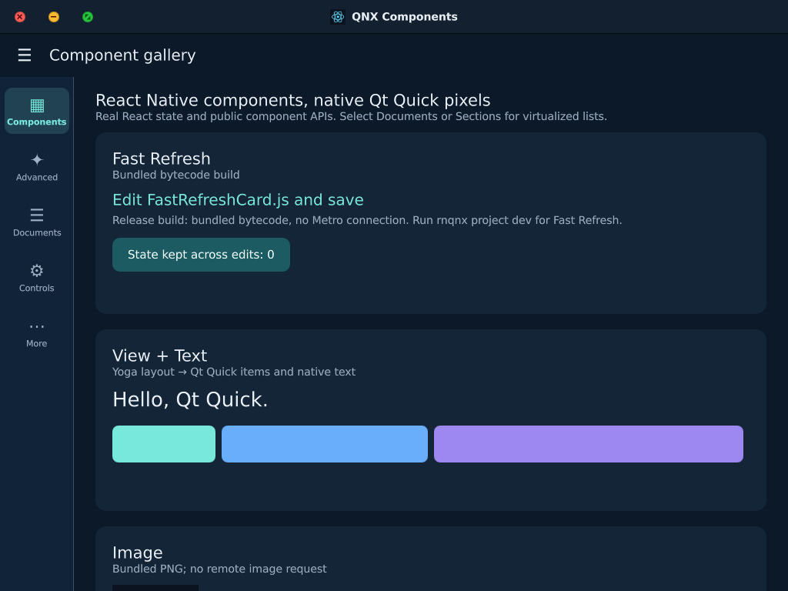

<div align="center">

# react-native-qnx

**React Native on QNX, rendered through Fabric, Hermes, Yoga and Qt Quick.**

[Documentation](https://mikevocalz.github.io/react-native-qnx/)

[](https://github.com/mikevocalz/react-native-qnx/actions/workflows/sdk58-validation.yml)
[](LICENSE)




<sub>The gallery app on a Raspberry Pi 400, 1024x768, from the [PR 149 run 2 receipt](docs/evidence/pr149-pi400-run2-2026-11-19/README.md).</sub>

</div>

## What it is

react-native-qnx is an out-of-tree React Native platform for QNX. JavaScript runs on Hermes, Fabric
and Yoga lay out the views, and a Qt Quick mounting layer draws them through QNX Screen. It is
v1 preparation software: one Raspberry Pi 400 on a custom BCM2711 QNX 8.0.5 image runs it, and all
eleven release gates in [`v1-readiness.json`](docs/releases/v1-readiness.json) are still pending.

It is not published to npm, it does not run Expo Go, and no stock Raspberry Pi 4 or Pi 5 result is
recorded here.

## Quick start (host preview)

This path runs on a Mac or Linux machine and needs no QNX SDP and no board. It builds the host
renderer, so the first CMake configure downloads and compiles Hermes, folly and Boost, which takes a
while. It proves your JavaScript bundles and renders. It does not prove anything about QNX.

You need Node 26 or newer, pnpm 12.18.0, CMake, Ninja and Qt 6.11.1 or newer
([toolchain notes](docs/toolchain.md)).

```bash
npm install -g pnpm@12.18.0   # or: npm install --prefix ~/pnpm12 pnpm@12.18.0, then see the note below
git clone https://github.com/mikevocalz/react-native-qnx.git
cd react-native-qnx
pnpm install --frozen-lockfile
pnpm qnx init dashboard
pnpm install --no-frozen-lockfile
pnpm qnx bundle-qnx --app dashboard --out build/dashboard.bundle.js
cmake -S . -B build/playground -G Ninja -DCMAKE_BUILD_TYPE=Debug -DRNQNX_BUILD_HERMES=ON
cmake --build build/playground --target rnqnx_playground_host
./build/playground/bin/rnqnx_playground_host --bundle build/dashboard.bundle.js
```

If you install pnpm into a prefix instead of globally, put it first on your PATH
(`export PATH=~/pnpm12/node_modules/.bin:$PATH`) and run
`node ~/pnpm12/node_modules/pnpm/install.js` once. npm blocks pnpm's install script, so
`pnpm` works from your shell but Node programs that start it with `spawnSync`, such as
`pnpm test:js`, fail with `ENOEXEC` until that script has run.

Append `-platform offscreen --screenshot build/dashboard.png` to the last command for a headless
capture. Run `pnpm qnx doctor` to see which QNX prerequisites your machine lacks.

To run on the Pi 400, follow [the Pi 400 guide](docs/getting-started/raspberry-pi-400.md), then
[runtime bring-up](docs/getting-started/pi400-hello-world.md) and
[the desktop app guide](docs/getting-started/pi400-desktop-app.md). The commands in those guides
are not part of the verified quick start above. For a stock Pi 4 or Pi 5 on QSTI 0.5.0 build 50, see
[the QSTI guide](docs/getting-started/raspberry-pi-today.md).

## Status

Each row comes from [`docs/component-support.json`](docs/component-support.json). The SHA is the
last commit that changed that row. Host means the host renderer tests. Pi 400 means scoped proof on
the one board described above. No row has Pi 4 QSTI evidence. The longer notes, with partial APIs
and no-ops, are in [component support](docs/component-support.md).

| Component                  | Host       | Pi 400     | Row last changed |
| -------------------------- | ---------- | ---------- | ---------------- |
| `View`                     | partial    | scoped     | `c50ce32`        |
| `Text`                     | partial    | scoped     | `c50ce32`        |
| `Image`                    | supported  | scoped     | `c50ce32`        |
| `ScrollView`               | supported  | scoped     | `c50ce32`        |
| `TextInput`                | partial    | scoped     | `5aba848`        |
| `Pressable`                | supported  | scoped     | `6e4882a`        |
| `FlatList`                 | supported  | scoped     | `c50ce32`        |
| `VirtualizedList`          | supported  | unverified | `0e87951`        |
| `SectionList`              | supported  | unverified | `0e87951`        |
| `VirtualizedSectionList`   | unverified | unverified | `0e87951`        |
| `Button`                   | supported  | unverified | `0e87951`        |
| `TouchableOpacity`         | supported  | unverified | `0e87951`        |
| `TouchableHighlight`       | unverified | unverified | `0e87951`        |
| `TouchableWithoutFeedback` | unverified | unverified | `0e87951`        |
| `ImageBackground`          | supported  | unverified | `0e87951`        |
| `KeyboardAvoidingView`     | no-op      | unverified | `0e87951`        |
| `ActivityIndicator`        | supported  | scoped     | `c50ce32`        |
| `RefreshControl`           | no-op      | unverified | `0e87951`        |
| `Modal`                    | partial    | scoped     | `79a4279`        |
| `SafeAreaView`             | partial    | unverified | `0e87951`        |
| `Switch`                   | supported  | scoped     | `c50ce32`        |
| `StatusBar`                | no-op      | unverified | `73ff82a`        |
| `QtVideo`                  | unverified | scoped     | `79a4279`        |
| `QtAudio`                  | unverified | scoped     | `79a4279`        |

Modules outside that table, with their device evidence. Run 2 used a build with Worklets,
Reanimated, Gesture Handler, Qt SVG and RNSVG on.

- Reanimated, with Worklets: `withSpring` ran to its end state and the UI frame counter advanced.
  [Run 2 receipt](docs/evidence/pr149-pi400-run2-2026-11-19/README.md), `22039ec`.
- Gesture Handler: pan with release and double-tap ([run 2](docs/evidence/pr149-pi400-run2-2026-11-19/README.md)); a single tap and a swipeable list ([run 1](docs/evidence/pr149-pi400-run1-2026-11-19/README.md)). Both at `22039ec`.
- `react-native-svg` 15.16.0: fill rules, gradients, filters, patterns, text and touch targets.
  Same receipt, `22039ec`.
- `expo-image`: animated GIF start and stop, and the resize and API card ([2026-11-13 receipt](docs/evidence/expo-image-device-2026-11-13), `df434d5`). Animated WebP frames and the resize card with `startAnimating` are in the [run 2 receipt](docs/evidence/pr149-pi400-run2-2026-11-19/README.md), `22039ec`.
- Keyboard: Escape closed a Modal and the drawer, and a held Down key moved a focus ring. The
  key events were synthetic Screen events, not a USB keyboard. Same receipt, `22039ec`.
- Audio: no component named QtAudio exists in the code. QtVideo plays audio files through Qt AudioOutput, and run 2 did not build it in.
  [Media receipt](docs/evidence/media-2026-11-13.md), `1a9e181`.

## Requirements

- Host for JavaScript work: macOS or Linux, Node 26 or newer, pnpm 12.18.0.
- Host renderer: Qt 6.11.1 or newer, CMake and Ninja. The quick start commands were run on macOS with Qt 6.12.0, CMake 4.4.5 and Ninja 1.13.2 ([receipt](docs/evidence/quickstart-host-2026-11-19.md)).
- QNX cross-builds: an x86-64 Linux host (Ubuntu 22.04 is the canonical one) with a licensed QNX SDP
  8.0.5, because SDP 8.0 ships Linux and Windows host tools only. `pnpm qnx doctor` reports gaps.
- Target: a Raspberry Pi 400 on a custom BCM2711 QNX 8.0.5 image, or a stock Pi 4 or Pi 5 on QSTI
  0.5.0 build 50 (no results recorded for the stock images). Qt for the target is built from open
  source ([ADR-0013](docs/adr/0013-open-source-qt.md)).

## Expo and the prebuilt runner

The CLI runs from this checkout. Expo SDK 58 is pinned, and development builds replace Expo Go
([ADR-0006](docs/adr/0006-expo-dev-builds.md)). To create a native Expo app, run
`node packages/react-native-qnx-cli/src/bin.mjs project create --project ../notes-qnx --app-id org.example.notes --name "Notes"`.
Add `--dry-run` to validate the path and identity first. See
[creating an Expo project](docs/getting-started/expo-project-create.md) and
[adding QNX to an existing app](docs/getting-started/expo-add-to-existing.md).

`pnpm qnx runner fetch` downloads and checksum-verifies a prebuilt development runner from a
manifest. No manifest is published yet, so you pass the URL of your own with `--manifest`. See
[ADR-0018](docs/adr/0018-runner-hosting-and-sdp-boundary.md).

## How it works

```text
React app (JS)  ->  Metro bundle, run by Hermes
Fabric shadow tree  ->  Yoga layout
Qt Quick mounting layer  ->  Qt Quick items, drawn by Qt
Qt QPA on QNX Screen  ->  the display
Nitro Modules  ->  native APIs from JS
```

Read the [architecture decisions](docs/adr/index.md) and the
[delivery plans](docs/platform-modernization/README.md).

## Known gaps

- No release gate has passed. The 11 gates in `v1-readiness.json` are all pending with empty
  evidence.
- Every device result comes from one Pi 400. Stock Pi 4 and Pi 5 are unproven.
- 1920x1080 is unproven on current builds. The Pi ran at 1024x768 because its monitor EDID is
  unreadable. An earlier 2026-11-07 Hello World capture is 1920x1080.
- Pinch, rotation and multi-pointer gestures are unproven. JavaScript still runs on the GUI thread,
  so a gesture that keeps running while JS is blocked is unproven too.
- A real USB keyboard held down is unproven. IME and software keyboards are unqualified.
- Video and Audio cards do not run in the current showcase build, because QtVideo was off in it.
  The Pi 400 image has no HDMI audio driver.
- The Nitro Pi 400 receipts (2026-11-07) ran Nitro `1.0.0-alpha.nightly.105.g69d365fc9b18`. The pin is alpha 136, and the Nitro device result was not rerun on it.
- Device performance is unmeasured. Host timings do not predict QNX numbers.
- `RemoteImageCard` load times of 154149 ms and 618203 ms in run 2 are unexplained.
- Per-key repeat counts and whether Modal `onRequestClose` fired on Escape rest on screenshots only.
- Hosted CI covers Linux host builds and source checks. It does not cross-build for QNX or run on a
  device ([required checks](docs/releases/required-checks.md)).

## Dependencies

<!-- generated:dependencies:start -->

| Component              | Pinned / resolved version               |
| ---------------------- | --------------------------------------- |
| reactNative            | `0.88.1`                                |
| react                  | `19.3.0`                                |
| expo                   | `58.0.24`                               |
| metro                  | `0.87.1`                                |
| reactNativeMetroConfig | `0.88.1`                                |
| babelPresetExpo        | `58.0.25`                               |
| nitroCore              | `1.0.0-alpha.nightly.136.gdb81de61bd32` |
| nitroModules           | `1.0.0-alpha.nightly.136.gdb81de61bd32` |
| nitrogen               | `1.0.0-alpha.nightly.136.gdb81de61bd32` |
| typescript             | `7.0.2`                                 |
| codegenTypescript      | `6.0.2`                                 |
| node                   | `>=26.0.0`                              |
| packageManager         | `pnpm@12.18.0`                          |
| expoModulesCore        | `58.1.0`                                |
| expoMetro              | `58.0.0`                                |
| expoMetroConfig        | `58.0.22`                               |
| hermesCompiler         | `260318099.0.5`                         |
| hermesSource           | `hermes-v260318099.0.5`                 |

<!-- generated:dependencies:end -->

## Docs, contributing, license

[Evidence gallery](docs/v1/evidence-gallery.md), [v1 documentation](docs/v1/README.md),
[compatibility matrix](docs/getting-started/compatibility-matrix.md),
[CLI commands](docs/getting-started/qnx-cli.md), [current state](docs/handoff/CURRENT_STATE.md),
[contributing](CONTRIBUTING.md), [security policy](SECURITY.md) and the
[premium-component policy](docs/policy/premium-components.md).

Repository code is [MIT](LICENSE). Dependencies keep their own terms: see
[third-party notices](THIRD_PARTY_NOTICES.md) and [packaging](docs/packaging.md).

Built on [React Native](https://reactnative.dev), [Hermes](https://hermesengine.dev),
[Yoga](https://www.yogalayout.dev), [Qt](https://www.qt.io), [Nitro Modules](https://nitro.margelo.com),
[Expo](https://expo.dev) and [QNX](https://www.qnx.com/developers/docs/8.0/).
