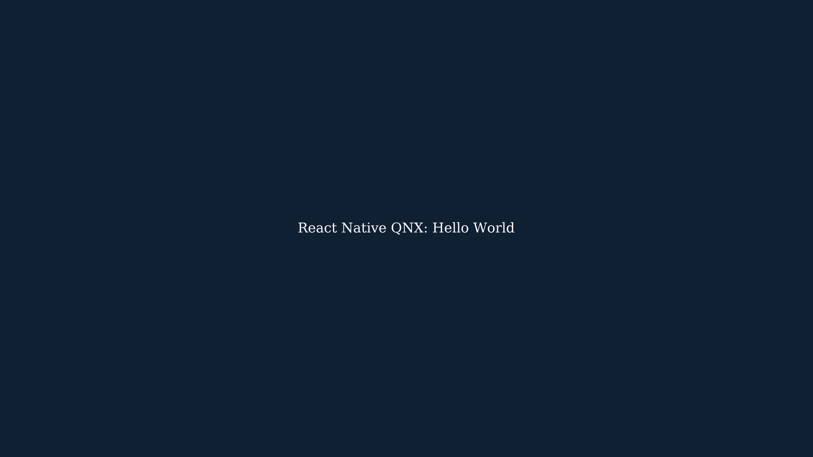

# react-native-qnx

Run React Native on QNX with Fabric, Hermes, Yoga and a Qt Quick view backend.
The experimental Pi 400 target renders Hello World at 1920×1080 on QNX SDP 8.0.5.



This is v1 preparation. Graphics cold boot, stock Pi 4 QSTI parity, performance
measurements and release packaging remain open. Development follows the
[open-source Qt path](docs/adr/0013-open-source-qt.md), with no paid Qt subscription
prerequisite. The Pi 400 receipts retain their evaluation-artifact provenance. Read
[the evidence boundaries](docs/handoff/CURRENT_STATE.md) and
[v1 gates](docs/releases/v1-readiness.md) before selecting a target.

## Start from source

Use Node 26+ and pnpm 12.8.1. The CLI operates inside this checkout; no npm
installation or standalone native-project support is claimed.

```bash
git clone https://github.com/mikevocalz/react-native-qnx.git
cd react-native-qnx
pnpm install --frozen-lockfile
pnpm validate:dependencies
pnpm qnx --help
pnpm qnx init dashboard
pnpm install --no-frozen-lockfile
pnpm qnx bundle-qnx --app dashboard --out build/dashboard.bundle.js
```

This creates a workspace app and a production QNX Metro bundle. To render it,
build the existing [host playground](docs/getting-started/qnx-cli.md#render-your-bundle-on-the-host)
and pass the bundle with `--bundle`. Native builds, QNX runtime deployment and
Qt provisioning have separate prerequisites.

For stock Pi 4/5 QSTI 0.5.0 build 50, use [the QSTI guide](docs/getting-started/raspberry-pi-today.md).
For the custom Pi 400 image, use [the Pi 400 guide](docs/getting-started/raspberry-pi-400.md)
and [runtime bring-up](docs/getting-started/pi400-hello-world.md).
`rnqnx_playground` is the Screen probe; `rnqnx_playground_qnx` is the React
Native runtime. See [CLI commands and limits](docs/getting-started/qnx-cli.md).

## Check your checkout

```bash
pnpm typecheck
pnpm test:js
pnpm validate:docs
pnpm validate:macos
```

The [React Pressable responder receipt](docs/evidence/pressable-qnx-2026-11-07.md)
records 23/23 host CTests with input/tracing ON and 16/16 with both OFF. Physical
Pi 400 synthetic Qt input exercises the production React Pressable responder
path, including remount recovery and failure controls. This does not establish
physical HID, RNGH or Worklets qualification; the input option remains OFF by
default.

The [bounded native tracing receipt](docs/evidence/pi400-runtime-trace-2026-11-07.md)
retains earlier 20/20 ON, 18/18 OFF and 4/4 focused queue-correlation results.
Physical Pi 400 export, protected-file failure, OFF-path capture and traced
Nitro worker/shutdown assertions passed at the cited revisions. These native
diagnostics do not establish input/Fabric/render-loop or presentation markers,
tracing overhead, or performance budgets. Tracing remains OFF by default.

`validate:macos` runs host checks. It does not cross-build or run QNX.
The dated handoff records earlier billing refusals.
[PR #68](https://github.com/mikevocalz/react-native-qnx/pull/68/checks) starts
hosted CI again; local passes remain separate. `pnpm validate:v1` checks the release
record and exits nonzero while required acceptance evidence is missing.

## Know what is supported

[Component support](docs/component-support.md) lists host, Pi 400 and Pi 4 QSTI
results separately, including partial APIs and intentional no-ops. Nitro v1
alpha is pinned exactly; sync HybridClass and optional async dispatcher device
proof are narrower than generic third-party module support. IME, multi-touch
and Reanimated integration remain gaps.

<!-- generated:dependencies:start -->

| Component              | Pinned / resolved version               |
| ---------------------- | --------------------------------------- |
| reactNative            | `0.88.1`                                |
| react                  | `19.3.0`                                |
| expo                   | `58.0.22`                               |
| metro                  | `0.87.1`                                |
| reactNativeMetroConfig | `0.88.1`                                |
| babelPresetExpo        | `58.0.23`                               |
| nitroCore              | `1.0.0-alpha.nightly.105.g69d365fc9b18` |
| nitroModules           | `1.0.0-alpha.nightly.105.g69d365fc9b18` |
| nitrogen               | `1.0.0-alpha.nightly.105.g69d365fc9b18` |
| typescript             | `7.0.2`                                 |
| codegenTypescript      | `6.0.2`                                 |
| node                   | `>=26.0.0`                              |
| packageManager         | `pnpm@12.18.0`                          |
| expoModulesCore        | `58.0.29`                               |
| expoMetro              | `58.0.0`                                |
| expoMetroConfig        | `58.0.20`                               |
| hermesCompiler         | `260318099.0.5`                         |
| hermesSource           | `hermes-v260318099.0.5`                 |

<!-- generated:dependencies:end -->

See [the compatibility matrix](docs/getting-started/compatibility-matrix.md),
[architecture decisions](docs/adr/index.md), [delivery plans](docs/platform-modernization/README.md),
[contributing](CONTRIBUTING.md) and [security policy](SECURITY.md).
The separate Linux/Wayland target is documented under [Marathon](docs/marathon/ARCHITECTURE.md).
Licensed app components follow [the optional premium-component policy](docs/policy/premium-components.md).

## License

Repository-authored code is [MIT](LICENSE). Dependencies retain their own terms;
see [third-party notices](THIRD_PARTY_NOTICES.md) and [packaging](docs/packaging.md).
