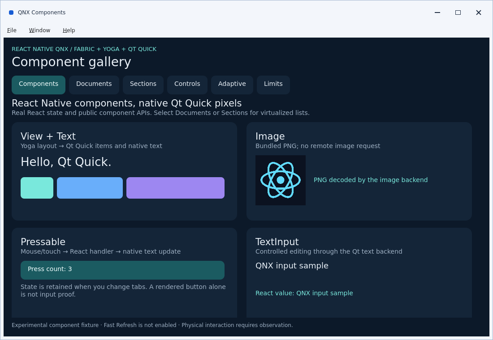
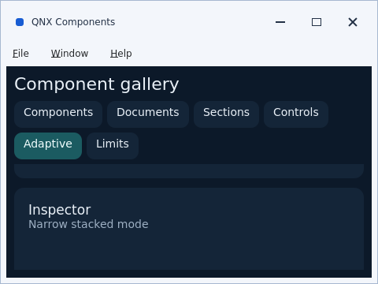

# Gallery input and desktop window repair: host evidence, 2026-11-09

The [2026-11-10 owner report](gallery-owner-report-2026-11-10.md) records subsequent
positive QNX feedback for the dependent PR #110. This dated receipt retains its
original host-only artifact and test scope.

The repaired gallery completes native Linux host interaction checks through the existing Qt Quick, Hermes, React and Fabric runtime. The final OFF configuration passed **18/18 CTests**. ON evidence combines **32 non-gallery passes from the preserved pre-compact full run** with a **final 2/2 gallery rerun**. A separate desktop configuration with the other experimental flags OFF passed **3/3 selected tests**. No physical QNX, QNX VM or Marathon/Wayland execution is claimed.

## Source identity and retained evidence

Production/test source is frozen at mirror commit `b194bef439879dcf7f6911e8adef1f9ae5cc38b2`, locally equivalent to `a3e282fbabc7fa40a0162f50028435ba4ba74884`. Both identify tree `905e42d1fa41e417ec78917845734f28b52a1bdb`. The source-manifest SHA-256 is `48025a67bceab501aca692c8c2b2975350e62d17ffd448454c85c47f34987f0f`. Subsequent evidence-only commits do not change that tested production/test source.

The [machine-readable receipt](gallery-desktop-host-2026-11-09.json) records flags, environment, artifact hashes and lane limits. The [combined native log](gallery-desktop-host-2026-11-09.log) retains final OFF, historical ON, final ON gallery and desktop-baseline output; local paths are normalized to `$CHECKOUT` and `$SESSION`, and trailing whitespace is removed. Original per-lane records are under `build/linux-gallery-clang/evidence/{off-final,on-compact,desktop-baseline}`; the pre-compact ON record remains separate.

The repair began from PR #104 head `7fd26983b04e44d15536144077b9b2a3e7d81082`. The owner observed physical rendering with failed tabs/buttons, reversed wheel movement and incorrect Switch appearance. That observation does not qualify this replacement. The installed historical ELF came from PR #102 native snapshot `1a294310612228139c19dca78fb0ec4ffab77ac6`, with SHA-256 `47ae39c5f00f7e2c9e35a3dcd5b111733a675915b97f87d7fbeafbf9d337ce26`. Preserve its install/qualification receipt; an HBC-only replacement cannot deliver these native repairs.

## Findings and resulting behavior

| Area                       | Finding and repair                                                                                                                                                                                                                                                                                                                                                               |
| -------------------------- | -------------------------------------------------------------------------------------------------------------------------------------------------------------------------------------------------------------------------------------------------------------------------------------------------------------------------------------------------------------------------------- |
| Baseline pointer delivery  | Production startup connected `QtTouchDispatcher` only under the default-OFF lifecycle flag. It now connects baseline Qt window → Fabric → React input in every build. Experimental cancellation remains flag-controlled. Decoration hits resolve to their Fabric ancestor and respect visual stacking.                                                                           |
| Client coordinates         | Desktop chrome shifts the React origin. Page coordinates now use the client root while screen and target-local coordinates remain correct. New contacts outside or within a disabled client are rejected; existing gesture termination remains supported.                                                                                                                        |
| Switch                     | A painting root produced opaque square corners and poor off-state contrast. Shared production/test QML uses a nonpainting root, gray off track and white thumb while preserving controlled value, disabled behavior, custom colors and Yoga dimensions.                                                                                                                          |
| Modal                      | Generic C++ Modal dimensions were zero, and scrolled visual ancestry could obscure content or admit background native input. Per-instance client dimensions, a visual portal preserving logical Fabric order, and a native pointer/wheel barrier repair this. Escape uses the existing `onRequestClose` event.                                                                   |
| Lists                      | Actual Documents/Sections mounting exposed a missing public `I18nManager` export. The getter now reuses pinned RN's optional-native-module implementation and LTR fallback. No native locale preferences or persistent RTL controls are added.                                                                                                                                   |
| Images                     | `SourceCode.scriptURL` was published after bundle initialization had cached the empty value, producing `file://assets/assets/icon.png`. Publish it before execution, normalize local paths to absolute encoded file URLs and preserve explicit URLs. Regression coverage checks initial constants, actual Metro resolution and PNG decode, including relative and escaped paths. |
| Desktop startup and resize | Initial anchored content could have negative dimensions and abort Yoga. Startup now waits for finite positive client geometry; screenshot mode fails without a usable viewport. Coalesced client changes update existing SurfaceHandler constraints, and resize validation preserves prior errors.                                                                               |
| Adaptive layout            | The Inspector clipped/overlapped at ordinary size, and minimum desktop size left a 27-pixel page viewport. Adaptive content now scrolls; compact chrome responds to actual height. The final minimum case has a 134-pixel page viewport, six visible tabs and simultaneously readable Inspector heading/detail.                                                                  |
| Desktop and wheel          | Default-OFF `RNQNX_ENABLE_DESKTOP_WINDOW` plus `--desktop` adds native menus, title controls, focus feedback and resizing. `--system-window-frame` delegates decorations to an existing manager. Explicit `--invert-wheel` reverses wheel deltas once while preserving metadata/acceptance and mouse/touch behavior; ordinary input remains unchanged.                           |

Fabric/Yoga/Hermes/JSI/Qt Quick remains the renderer. These changes add internal host integration and expose an existing RN implementation; they introduce no new TurboModule service, replacement renderer, Qt Widgets dependency, paid Forge dependency, ABI upgrade, platform identity change or dependency-pin change. New public services remain governed by the pinned Nitro v1 policy. Launch/deployment details are in the [desktop consumer guide](../getting-started/desktop-window.md).

## Final native results and their scope

Host: Linux x86_64, Qt 6.11.1 offscreen/software, Ubuntu Clang 18.1.3, CMake 3.31.10, Ninja 1.13.0, Node 26.0.0 and pnpm 12.8.1. Earlier focused Qt fixtures also used GCC 13.3. The full Clang graph compiled successfully.

| Configuration / record                                                                  | Actual execution                                                      | Result                                                                                                                                                |
| --------------------------------------------------------------------------------------- | --------------------------------------------------------------------- | ----------------------------------------------------------------------------------------------------------------------------------------------------- |
| `off-final`: input lifecycle, text-input contract, accessibility bridge and desktop OFF | Complete final 18-case CTest inventory                                | **18/18 passed, 145.52 s**                                                                                                                            |
| ON: all four features ON                                                                | Preserved pre-compact full 34-case run                                | **33/34 passed**: all 32 non-gallery cases and ordinary gallery passed; desktop gallery failed minimum layout. This failure is retained.              |
| `on-compact`: all four features ON                                                      | Final ordinary and desktop gallery rerun after compact-layout repair  | **2/2 passed, 53.33 s**. Together with the earlier 32 non-gallery passes, this supplies the stated ON evidence; it is **not a new single 34/34 run**. |
| `desktop-baseline`: desktop ON; lifecycle, text-input and accessibility OFF             | Only desktop-window, desktop-consumer-input and desktop-gallery tests | **3/3 passed, 39.05 s**. There were **21 registered tests**, not 21 executed tests.                                                                   |

The selected desktop times were 1.31 s, 7.87 s and 29.87 s respectively. These are test durations, not application performance benchmarks. Local execution does not establish the GitHub Actions result of a subsequently published head.

ASan covers the consumer, gallery, full React host and desktop **test executables**. Wheel and mounting test executables use ASan+UBSan. Static renderer libraries compile with strict warnings without sanitizer instrumentation; linked Qt libraries are not wholly instrumented. Qt singleton leak detection is disabled under the repository convention. The desktop-baseline gate did not rerun wheel or mounting tests.

Earlier focused evidence remains valid within its scope: the exact original Switch QML failed the same pixel regression the candidate passed; wheel tests passed after final review in 0.35 s; mounting passed all 17 cases; desktop tests exercised real Qt mouse/keyboard delivery. QML lint on all four desktop files and the Qt C++ desktop/wheel review linter reported zero findings. Their narrower results do not replace the final runtime lanes above.

## What the actual gallery exercised

`QtComponentGalleryTest.cpp` compiles the production startup and drives Qt window events. It does not call JavaScript handlers, access the Zustand store directly or install a test-only dispatcher. Its real Metro bundle uses public imports and descriptor identity `org.rnqnx.showcase` / `QNX Components` / `RNQnxPlayground`; the tracked PNG is staged at `assets/assets/icon.png` relative to that bundle.

The passing sequence visits Components, Documents, Sections, Controls, Adaptive and Limits, then returns. It observes counter progression to three, Switch OFF→ON, selected `document-0001` retained across pages, actual PNG decode, and retained control state. It opens Modal from scrolled content, checks background blocking, dismisses with the button and Escape, and resumes underlying interaction. Desktop execution additionally checks minimum-size usability, wide layout and React's observed width against the actual client width. Separate consumer tests cover padding/text hits, repeated/disabled presses, scrolled Modal coverage, native Switch and wheel isolation, resize and post-modal use; a negative interception case must fail when window presses are blocked.

The wrapper requires successful exit **and** the interaction-completion marker. It rejects JS fatal/task/error diagnostics, image-open/decode errors, layout failures and sanitizer diagnostics even when the process returns zero. A bounded controlled-process review verified all ten acceptance/rejection cases; a separate clean metadata check verified the PNG hash. Required-test inventory checks reject missing ordinary or desktop cases. These checks do not substitute for native execution.

The final gallery bundle SHA-256 is `323838b09d1ce652d47c3e7a325077a1222608e30fdecf7a6c545c2fa5aabbe1`; staged PNG SHA-256 is `cab067bf7b80610d922299070b649dc414b7939294b16f4f396adbeaf122ff02`. Both are recorded per lane with executable hashes. The frozen lock SHA-256 remains `b854ebe2e50a42b2e8e07124df065592d99d43b1d1a3a984b66d3835ad86c3e4`. Earlier gallery bundle `cf621bd1cbf52f235b3ac399bcfa707d1f05bd16e313bc397b42407d5d5e723c` is historical, not the final artifact.

Other completed gates: focused gallery/public-entry VM tests, expanded fail-closed inventory tests, TypeScript, dependency validation, documentation validation and **full Prettier check**. Public Metro bundles passed for QNX (**682,938 bytes**) and Marathon (**682,979 bytes**). These are JavaScript/build checks, not Marathon target execution.

### Retained host screenshots

Both images come from the final desktop-baseline configuration, with desktop ON and the other three features OFF. Their hashes are in the JSON receipt.

## Historical failures preserved

The initial GCC full build failed in installed RN source on Clang diagnostic pragmas, then `NetworkIOAgent.h` anonymous-namespace linkage under `-Werror=subobject-linkage`. No warning exception was committed. The successful Clang route used official Ubuntu packages extracted into a local prefix after signed-index, SHA-256 and size verification: 13 archives, 83,846,644 bytes. No system-package or compiler-policy change was required.

Published intermediate head `c8e8adca66259f91b6d3408ccf9ea813ca58f474` failed stale inventory fixtures and a Modal test assuming one visual child despite the deliberate native barrier. Tests now require the expanded inventory and verify actual React content/geometry without weakening failure checks. Its ON desktop consumer also exposed the negative initial viewport/Yoga assertion repaired above. Initial actual-gallery smoke exposed the missing I18nManager and malformed image URL despite process exit zero. Those failures motivated the real-app gate.

The preserved ON **33/34** run subsequently caught the unusable minimum Adaptive layout. The final compact rerun addresses that observed failure; the report does not rewrite the historical full run as passing. An earlier broad local `test:js` attempt was blocked by the launcher fixture's Unix-socket `listen EPERM`; no full local JS-suite pass is inferred from focused checks.

## Sources, skills and review ownership

| Skill/source                                                                   | Exact revision/version                                                             | Decision applied                                                                                                                          |
| ------------------------------------------------------------------------------ | ---------------------------------------------------------------------------------- | ----------------------------------------------------------------------------------------------------------------------------------------- |
| Margelo `api-design` → `build-nitro-modules` → `cpp`                           | `margelo/react-native-skills` at `1e9e17be6f41c838db472d6a4b943fc26355a3be`        | Separate public contracts from internal host plumbing; use actual pinned Nitro v1 for new services and preserve Qt/JSI ownership.         |
| Callstack `react-native-best-practices`, `writing-user-docs`, `github-actions` | `callstackincubator/agent-skills` at `59e9d17446a248b21d86f078fcd0bd2d36db1ca4`    | Validate React state through native events, document launch/deployment boundaries and extend the existing CI matrix with exact artifacts. |
| Qt `qt-qml`                                                                    | `TheQtCompanyRnD/agent-skills` at `062f7c9f0e16b7d2f66cd55e449a3ed85fba699e`, v1.3 | Use scoped Basic controls, explicit bindings, a nonpainting root and native focus feedback.                                               |
| Qt `qt-ui-design`                                                              | Same revision, v1.1                                                                | Respect desktop display and keyboard/mouse interaction while keeping application layout in Yoga.                                          |
| Qt `qt-cpp-review`                                                             | Same revision, v3.0                                                                | Review RAII, window/engine lifetime, thread ownership and QML integration; repair release-elided assertions and macro-sensitive limits.   |
| Repository `qnx-native-api`, `qnx-platform-validation`                         | PR #104 base `7fd26983b04e44d15536144077b9b2a3e7d81082`                            | Separate source, host, historical installed binary and physical acceptance evidence.                                                      |
| Neutrino Programmer's Guide and System Architecture                            | `Himmele/My-Blog-Repository` at `b1fd3e9410c1a6a0d7217c3be7e324e900470d2a`         | Inform lifetime, bounded work and recovery review; these QNX 6.3-era books are not QNX 8 API authority.                                   |

Pinned upstream skills were read and applied; no personal skill installation, vendor review or endorsement is claimed. Automated roles follow the roster: the platform integrator owns desktop production code, CI/evidence and independent seam review; the RN input/runtime agent owns dispatcher, Modal, resize and production-window driver; the Qt/RN reviewer owns Switch, desktop/React tests and actual-gallery/Adaptive validation; the QNX regression agent owns wheel qualification, current QNX sources, host toolchain and SourceCode/image regression. Cross-review covered Modal, wheel, public I18nManager and the gallery runner. Human DRI and maintainer acceptance remain unassigned.

## Remaining qualification and rollback

The [desktop guide's primary sources](../getting-started/desktop-window.md) identify QNX Everywhere issue **QNXE-1445** as a possible wheel-reversal match, not a diagnosis of this image. Qt 6.12 QNX explicitly lacks native minimize; the app disables that action there. System-frame minimize/restore still requires an existing, verified desktop manager and physical testing. No boot or manager changes were made.

Rebuild and qualify the new native ELF/HBC with matching target Qt Controls/Basic dependencies, then record actual QNX Screen/QPA/image/manager identity and physical mouse, keyboard, wheel and window behavior. No QNX VM or Marathon/Wayland compositor, permissions, shell integration or installed-package qualification occurred. Full React keyboard/IME/accessibility parity, native file dialogs and app-specific Open/Save remain separate work. No frame-time, latency, memory or throughput improvement is claimed. Pins and security/licensing boundaries are unchanged; matching Qt notices and separate QNX runtime terms still apply. Keep PR #104 draft pending target acceptance.

Omit `--invert-wheel` for standard wheel interpretation. Omit `--desktop` or build desktop OFF for the ordinary window; baseline input/Modal repairs remain. To restore the old implementation, revert the repair and rebuild, preserving the historical ELF/HBC and launch command separately. Never associate a new bundle receipt with the old native binary hash.
