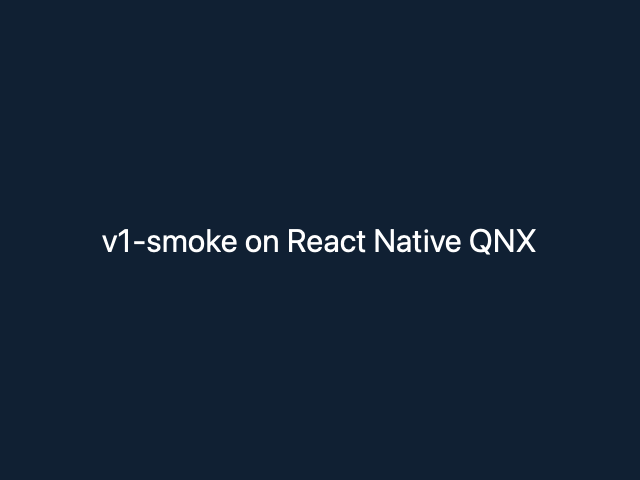

# V1 preparation: host validation, 2026-11-07

Base: `be71bc9` (`main`, merge of PR #64). Implementation branch:
`codex/qnx-v1-polish`. This receipt covers source-checkout tooling and
records historical device evidence separately. No QNX host, VM or physical
board was contacted for this change. Selected actual command outputs are in
[the sanitized log](v1-polish-host-2026-11-07.log); download/compile progress is omitted.

## Scope and source inspection

- `packages/react-native-qnx-cli/src/cli.mjs:main` validates commands and uses
  argument arrays with `shell: false`. `init` exclusively creates a destination;
  `execute` propagates child status and forwards SIGINT/SIGTERM.
- Installed `metro@0.87.1/package.json:bin` is the string `src/cli.js`.
  The CLI resolves that actual entry instead of assuming an object-shaped bin.
- `vnext/probes/playground/main.cpp:main` accepts `--bundle` and starts
  `RNQnxPlayground`. The template preserves that registered surface name.
- `scripts/{configure,build,deploy,run,log}-qnx.sh` retain their existing target
  environment and native executable contracts. `log-qnx.sh` now preserves SSH
  failure status. The CLI does not provision Qt or rewrite target boot.
- `scripts/run-js-tests.mjs:main` now fails for an absent/empty suite and an
  ENOENT thrown by a test; a missing receipt cannot turn into a successful skip.
- `scripts/lib/docs-model.mjs:dependencyBaseline/syncDocs` derives active pins
  and checks curated component/device and release records. Device receipts are
  separate for Pi 400 and Pi 4 QSTI. Missing release gates cannot disappear
  silently. The schema-2 project state has no legacy script consumers in the
  inspected `scripts`, `tests` or `.github` paths.
- `QnxWebSocketModule.cpp:disabled` throws when the backend is off;
  `cmake/RnqnxWebSockets.cmake` rejects the experimental flag on QNX.
  The support page now reflects those source boundaries. FileReader/segment
  operations remain unsupported, rather than counting as functioning no-ops.

No renderer, native API, ABI pin, CMake option, manifest plugin, app window
contract or runtime scheduling behavior changed. Forge remains an optional
licensed consumer integration.

## Host environment and commands

macOS 27.0 / arm64; Node 26.13.0; pnpm 12.8.1; CMake 4.4.5; Ninja 1.13.2;
AppleClang 21.0.0.21000334; host Qt 6.12.0 from Homebrew.
Frozen lock SHA-256:
`e9602379b5849218cef9718da6db4430e36b51382fd787dcfbecb8269c0aaa52`.
No dependency versions or lockfile resolutions changed.

| Command / check                                                                | Actual result                                                                 | Limit                                                                                                                                      |
| ------------------------------------------------------------------------------ | ----------------------------------------------------------------------------- | ------------------------------------------------------------------------------------------------------------------------------------------ |
| `pnpm install --frozen-lockfile`                                               | Passed before and after the transient app test                                | Existing host dependency cache; not a clean machine                                                                                        |
| `pnpm validate:dependencies`                                                   | Passed installed exact pins and source contracts                              | Source inspection, not a QNX ABI/runtime test                                                                                              |
| `pnpm typecheck`                                                               | Passed TypeScript 7 with CLI and scripts included                             | No native compile claim                                                                                                                    |
| `pnpm test:js`                                                                 | Passed 21 test modules                                                        | Includes host/simulated shell/watchdog tests; no target connection                                                                         |
| `pnpm format:check`                                                            | Passed                                                                        | Repository formatting                                                                                                                      |
| `pnpm validate:docs`                                                           | Passed 22 components and 7 release gates                                      | Checks generated records and local link paths; reviewers still judge evidence contents                                                     |
| `pnpm validate:architecture`, `pnpm validate:manifests`, `pnpm build:packages` | Passed                                                                        | Private source CLI; package build scripts are not npm publication                                                                          |
| `pnpm codegen:check`, `pnpm nitro:platform:check`                              | Passed constrained platform binding check                                     | General upstream QNX Nitrogen generation remains unavailable                                                                               |
| `pnpm audit:dependencies`                                                      | Passed; registry returned zero advisories; installed braces backport verified | Registry response at this run only                                                                                                         |
| `bash -n` and `shellcheck -x scripts/log-qnx.sh scripts/validate-macos.sh`     | Passed                                                                        | Local shell analysis                                                                                                                       |
| `pnpm validate:v1`                                                             | Expected nonzero exit 1, naming all 7 open gates                              | A successful docs check is separate from release acceptance                                                                                |
| `coderabbit review --agent --base-commit be71bc9`                              | Completed, 0 findings across 38 files                                         | Automated implementation review; later support-note edits and additive test assertions were manually reviewed; maintainer approval pending |

The CodeRabbit implementation snapshot's index tree was
`f824222c3c0167bebea26bfb9c8c40105a50a41b`. The final PR adds this evidence and
minor documented follow-ups. Upstream maintainers are references, not assigned
reviewers.

## Native host run and failure record

The default `pnpm test:cpp:host` attempt failed while archiving
`librnqnx_fabric_adapter.a`: `write64() failed ... errno=28` (disk full).
No source compile error was observed in that attempt. Only this checkout's
failed generated build directory was removed. Unrelated builds were preserved.

The smaller configuration below then configured, built and passed **7/7** CTests:

```bash
cmake -S . -B build/v1-host-sanitizers -G Ninja \
  -DCMAKE_BUILD_TYPE=MinSizeRel -DBUILD_TESTING=ON \
  -DRNQNX_ENABLE_HOST_SANITIZERS=ON
cmake --build build/v1-host-sanitizers --parallel 4
ctest --test-dir build/v1-host-sanitizers --output-on-failure
```

This includes Screen fake, RN header, shadow mutation/tree, Qt mounting and
Qt Quick probe tests. The repository applies ASan/UBSan to the Screen and Qt
mounting test harnesses; leak detection is disabled for documented Qt lifetime
singletons. This is not whole-graph sanitizer coverage. Hermes and optional
Nitro dispatcher builds are OFF in this fresh 7-test graph. It is not the older
16-test full Hermes/Nitro receipt and is not QNX execution.

## Create, bundle and render an app

The actual CLI procedure ran in this checkout:

```bash
pnpm qnx init v1-smoke
pnpm install --no-frozen-lockfile
pnpm qnx bundle-qnx --app v1-smoke --out build/v1-smoke.bundle.js
```

It produced a 482418-byte production bundle, SHA-256
`9e7a4127a661ef08eaedd59789d6bf56394cdcb219a142af44087aab16621e25`.
The temporary app was then removed, its lockfile addition restored to the
pre-test bytes, and the frozen install passed again.

A separately existing `rnqnx_playground_host` binary rendered that new bundle
with `--bundle`, `-platform offscreen` and `--screenshot`; exit 0:

```text
Running "RNQnxPlayground"
RNQNX_PLAYGROUND_SCREENSHOT $CHECKOUT/build/v1-smoke.png 640x480
```

Runner SHA-256:
`7e6a60dc7f8a37520888eedc5a0766619737fb72498da98ac77012aa02c21087`.
This reused the existing runtime-trace checkout's host runner; it was not
rebuilt by this PR's 7-test graph. Font-alias and shutdown logging warnings
were present. The screenshot validates the generated app's host integration
with that runner, not a new native binary or QNX device run. Window dimensions
remained 640×480; no fullscreen or orientation setting changed.



Image SHA-256:
`40dafd15c879f29eb35b0c29ed1597c86e7fc6a8dff854f025dde588c153ad67`.

The unchanged playground also bundled for QNX and Marathon:

```bash
# From apps/rn-playground
pnpm exec metro build index.js --config metro.config.js --platform qnx \
  --dev false --max-workers 2 --out ../../build/v1-playground-qnx.bundle.js
pnpm exec metro build index.js --config metro.marathon.config.js --platform marathon \
  --dev false --max-workers 2 --out ../../build/v1-playground-marathon.bundle.js
```

Bundle SHA-256s: QNX
`62fcfc7ca64965ebf13beea2549c7ab25f786dd5ee6e389958003f745045be2a`;
Marathon `1e01bb4af504b06a9fcf1c71ada93f990c8399eba32600b070cf191d534f59aa`.
Existing resolver tests passed. No resolver, platform override or playground
source changed. Neither bundle result establishes Marathon shell or QNX device
support.

## Applied skills and review ownership

| Skill                         | Exact source / version                                                                                                           | Applied decision                                                                                                     |
| ----------------------------- | -------------------------------------------------------------------------------------------------------------------------------- | -------------------------------------------------------------------------------------------------------------------- |
| QNX Platform Validation       | Repository skill at base `be71bc9`; SHA-256 `92012064c52eea4e2d68f92b12d54f6d3952c966e34f594b81be5ce99457c993`                   | Keep candidate host, reused host runner and historical physical receipts separate; retain failed and missing gates   |
| `writing-user-docs`           | Callstack `59e9d17446a248b21d86f078fcd0bd2d36db1ca4`; SHA-256 `b631015f194cae5c40dbadff8d1a67da3124613157c58c033b7a503cbaad59ba` | Put source-checkout limits and the second workspace install before the bundle procedure; document errors             |
| `create-react-native-library` | Same Callstack revision; SHA-256 `72fc31f0dbf032ce27d0ea9966d0e2bc946283639c6200f5696307d4cde3e4ef`                              | Inspected for scope; generic Apple/Android native scaffolding does not match this QNX source CLI, so it was not used |
| `no-ai-slop`                  | Installed skill; SHA-256 `992b365f51a2f62cf4c1c5ed22049a9ee551dfea677550c1a72b371c0ceadd62`                                      | Replace duplicated README policy with a link; shorten support notes and preserve concrete limits                     |
| `code-review`                 | Installed skill version 0.1.0; CodeRabbit CLI 0.7.6                                                                              | Review the implementation diff, separately from maintainer approval                                                  |

Source files were read. No upstream skill-installer or native/API migration
pipeline execution is claimed. DRI role: Codex implementation on behalf of the
repository owner. Independent automated reviewer: CodeRabbit. Human release/QNX
reviewers remain unassigned; no external author's participation is implied.

## Limits, security, licensing and rollback

QNX device, cold boot, stock QSTI parity, physical keyboard/touch, IME and QNX
performance tests were not run. Startup/frame/RSS budgets are **unmeasured**.
The [v1 record](../releases/v1-readiness.md) stays blocked/pending. The existing
Pi 400 app, Qt evaluation payloads, graphics stack and recovery boot were not
changed. No binary distribution, release tag or npm publication occurs.

The root MIT file formalizes the manifest's existing project license.
Third-party terms and Qt/QNX distribution decisions remain separate; the
public-source LGPL rebuild is an investigation proposal. No vendor payload or
premium component is included. CLI subprocesses use validated argv and retain
the shell scripts' existing target checks.

Rollback: revert this PR; no native ABI, dependency pin, window or target boot
migration is needed. Generated apps are explicit source additions; removing an
app requires removing its workspace importer through pnpm. Next slice: resolve
the distribution and authorized CI runner gates, then qualify cold boot and
component/performance behavior on the release board/image.
