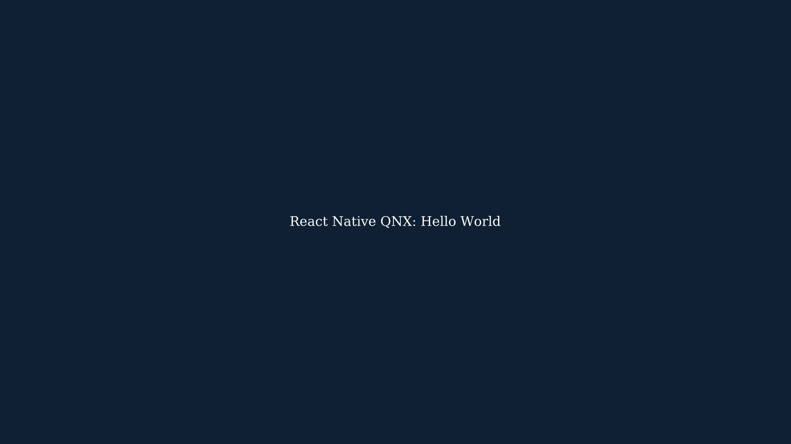

# Minimal React Native Hello World

`apps/rn-playground/hello-world.js` is a separate static entry for the existing
Qt Quick/Fabric playground runner. It registers the existing `RNQnxPlayground`
surface and renders a centered white `React Native QNX: Hello World` on a dark background.
It leaves the default playground, native window dimensions, Metro platform,
renderer, and dependency versions unchanged.

## Build the QNX JavaScript bundle

From the repository root:

```sh
pnpm install --frozen-lockfile
mkdir -p build/hello-world
(
  cd apps/rn-playground
  ../../node_modules/.bin/metro build hello-world.js --platform qnx --dev false \
    --out ../../build/hello-world/hello-world.bundle.js
)
```

For the QNX lean VM, also compile this bundle using the matching host compiler:

```sh
: "${RNQNX_HOST_HERMESC:?Set this to the matching host hermesc executable}"
"$RNQNX_HOST_HERMESC" -O -emit-binary \
  -out build/hello-world/hello-world.hbc build/hello-world/hello-world.bundle.js
```

Both bundle formats were prepared; compiling bytecode does not execute React
Native. The existing native playground expects `RNQnxPlayground`. Select this app by
passing the generated file explicitly with `--bundle`; replacing the default
playground entry is unnecessary.

## Physical QNX execution prerequisites

The JavaScript bundle alone is not executable on QNX. The actual application
needs the existing React Native/Fabric/Hermes/Qt Quick native host, matching
QNX AArch64 libraries, a working QPA/Screen configuration, and the deployed
bundle. The current QNX CMake graph exposes the geometry-only
`rnqnx_react_qnx_probe`; the existing visual runner is now also exposed as the opt-in
`rnqnx_playground_qnx` target. Its source and 640×480 window are shared with
`rnqnx_playground_host`; the QNX visual target completed its cross-build and physical Hello World
rendering check on 2026-11-07.

The repository's [ADR-0001](../adr/0001-qt-quick-backend.md) requires a documented
licensing determination before acquiring, building, or deploying Qt for QNX.
The current native graph requires Qt 6.11.1 or newer, including Core, Gui, Qml,
Quick, and Network. Do not replace it with an older package or a different
renderer to skip that gate.

## Recorded preparation

On 2026-11-06, the entry bundled successfully for `qnx` with the locked
React Native 0.88.1 / React 19.3.0 / Metro 0.87.1 graph. Dependency/source
validation, TypeScript, repository JavaScript tests, and entry formatting
passed. An independent source review found no renderer or window-contract
change.

Separately, the existing `rnqnx_g0_cxx20_probe` and direct-Screen
`rnqnx_playground` cross-built with QNX SDP 8.0.5. Those are prerequisite
binaries, not execution of this React Native entry. After reconnecting the Pi,
the new C++20 probe executed and reported
`RNQNX_G0_CXX20_OK ranges=12 designated=21 thread=34 jthread=unsupported`.
At that preparation stage, the Hello World bundle had only been copied to the
device. The later physical rendering result below supersedes that limitation. The Screen probe has not run successfully
on the device. The seven available macOS CTests passed; they do not include a
full Hermes/React Native application rendering pass.

The pinned Hermes `hermes-v260318099.0.5` lean library and JSI cross-built
with QNX SDP 8.0.5. The physical `rnqnx_hermes_qnx_probe` then passed as
`qnxuser`, including main-thread execution and worker stacks of 256 KiB and
1 MiB. See [the captured output](../evidence/pi400-hermes-2026-11-06.txt).

This required three corrections: excluding the unavailable `madvise` call
from the QNX branch, replacing guessed stack bounds with QNX thread-status
bounds, and defining `_QNX_SOURCE` in the canonical Pi toolchain. Without
that feature macro, strict C++ headers selected a smaller `pthread_attr_t`
layout than target libc, and `pthread_attr_init` overwrote the stack canary.
The native worker-stack checks exercise that failure as well as runtime
initialization. Native stack protection remains enabled.

The lean VM accepts bytecode, not JavaScript source. With the pinned host
compiler selected by `scripts/configure-hermes-qnx.sh`, compile the probe:

```sh
: "${RNQNX_HOST_HERMESC:?Set this to the matching host hermesc executable}"
"$RNQNX_HOST_HERMESC" -O -emit-binary \
  -out build/qnx-aarch64-debug/bin/bytecode-smoke.hbc \
  vnext/probes/hermes/bytecode-smoke.js
```

Deploy the probe, `libhermesvmlean.so`, and `bytecode-smoke.hbc` together, then
run in that target directory:

```sh
LD_LIBRARY_PATH="$PWD:/usr/lib" ./rnqnx_hermes_qnx_probe bytecode-smoke.hbc
```

Require exit status zero, both `RNQNX_HERMES_QNX_STACK_OK` lines, and the final
`RNQNX_HERMES_OK bytecode` marker. The script checks arithmetic, ES6 constructs,
async-arrow execution, and a call into the native JSI host function. This is
engine/JSI evidence; it does not run React Native or render this Hello World.
The existing host probe still runs its source-based checks without arguments.

The packaged graphics server rejected `RaspberryPi400`. An isolated official
legacy Pi 4 graphics stack created the DRM and Screen devices, detected HDMI2,
and rendered the vendor gears demo using Broadcom V3D 4.2. A Screen screenshot
and the user's physical HDMI observation confirmed that output. The Ethernet
link dropped repeatedly; the graphics startup was subsequently saved, but the following cold boot
returned neither Ethernet nor HDMI signal. A recovery boot file restored
the original startup and disabled the graphics compatibility attempt. Physical
Ethernet, qconn, and SSH access were then verified again. Automatic graphics startup remains disabled in that recovery boot. A later
controlled manual DRM/Screen/gears run remained remotely reachable while the
Hermes tests ran. This does not establish reliable graphics startup on cold
boot. The gears demo is not this React Native application.

**Status (2026-11-07): physical React Native/Fabric/Hermes/Qt Quick Hello World verified.**
The same app passed the existing synchronous Nitro v1 binding check. A 640×480
capture shows the requested title centered over the full dark app background.
The capture run exited zero; the app was then launched continuously for HDMI.
See [captured evidence](../evidence/pi400-hello-world-2026-11-07.txt).
Automatic graphics startup remains disabled; this is a manual recovery-boot run.

## Temporary Qt evaluation

The owner requested and activated a Qt for Device Creation Enterprise evaluation.
The account displays an expiry of 17 November 2026. Qt 6.12.0 LTS source was
acquired through that account. The selected target runtime cross-built, and a
standalone Qt Quick window rendered on the physical Pi as `qnxuser`, exiting
zero. A Screen capture verified the text `Qt Quick on QNX`. This prerequisite
window does not execute React Native. See ADR-0001 for the restricted evaluation scope.

## Opt-in QNX visual runner

With the licensed matching Qt QNX build available, configure the existing QNX
preset with `RNQNX_BUILD_HERMES_QNX=ON`, `RNQNX_BUILD_REACT_QNX=ON`,
`RNQNX_FETCH_REACT_NATIVE_DEPS=ON`, and `RNQNX_BUILD_PLAYGROUND_QNX=ON`.
Use the matching target Qt SDK generated `qt.toolchain.cmake`, with
`QT_CHAINLOAD_TOOLCHAIN_FILE` selecting the canonical QNX toolchain and
`QT_HOST_PATH` selecting matching runnable host tools. Build
`rnqnx_playground_qnx`. The new flag defaults OFF and rejects host builds or
a missing React target graph. Both negative cases were checked.

Deploy the actual Qt platform/QML plugins and shared-library dependency closure,
including `QtQuick.Shapes`, Qml Models/WorkerScript, PNG support and fonts. The
unchanged View factory imports Shapes even for this small app. Run the visual
target with `--bundle hello-world.hbc`; its file-loading path preserves binary
bytecode. The React Native target cross-built, loaded the compiled Metro entry, and
rendered on the physical Pi as `qnxuser`. The selected Qt runtime closure was
also exercised independently by the standalone Qt Quick window.

CMake's QCC MOC predefinitions command omits normal compiler flags and its generic
compiler-target setting. The canonical toolchain now repeats the locked ARM
selector and `_QNX_SOURCE` in `CMAKE_CXX_COMPILER_ARG1`, which that command does
include. The generated Qt Core predefinitions command was checked, Qt Core
compilation passed that previously failing step, and a fresh C++20 target plus
the existing Hermes bytecode checks passed on the recovered physical Pi.

A subsequent minimal automatic graphics experiment also failed a reboot/power
cycle test (black/no HDMI and no physical Ethernet link). The exact saved
recovery boot config was restored from the Mac; the recovery image checksum was
verified and system/data partitions were untouched. Network access and manual
DRM/Screen/gears then returned, with both physical probes passing again.
Automatic graphics remains disabled. The stock startup script's conditional
desktop-client launch is a source-backed difference from the successful manual
path, not a proven explanation of the boot failure; no helper log was created
by the failed boot.

For the preserved 640×480 window, select `QT_QPA_PLATFORM=qnx:no-fullscreen`.
Qt 6.12.0's `qqnxintegration.cpp` enables `FullScreenApplication` unless that
parameter is present; this environment setting preserves the existing window
contract rather than changing the runner's dimensions.

## Physical Qt and Folly prerequisites (2026-11-07)

The selected Qt 6.12.0 runtime includes Core, Gui, Network, OpenGL, Qml,
QmlMeta, QmlModels, QmlWorkerScript, Quick and QuickShapes, the QNX QPA plugin,
and the required QML plugins. It is installed privately under `/data/qt612`;
system libraries were not replaced. Named-user read/write ACLs on
`/dev/drm/card0` and `/dev/drm/renderD128` allowed `qnxuser` to initialize EGL.
Screen's administrative command permissions were not widened. This manual
setup has not been validated across reboot.

Matching Linux host tools report 6.12.0. The account Qt Declarative source tag
differs from the public host package's recorded revision; all 8,109 compared
build source, tools and CMake members match the public tagged source bytes.
This verifies the compared build content, not identical repository revisions.

QNX-only, exact-source checked patches adapt pinned Folly/glog namespace,
syscall-header and thread-ID assumptions. The Folly socket batch wrappers use
their existing per-message portable fallback on QNX; native batching has not
been accepted. `rnqnx_folly_qnx_probe` passed as `qnxuser`, checking main and
worker thread IDs, unsupported syscall reporting, and a two-datagram batch
round trip: `RNQNX_FOLLY_QNX_OK threads=2 batch=2 syscall=ENOSYS`, exit zero.
This does not assert Linux syscall or batching timeout parity.

The QNX React Native graph applies exact-source checked GCC portability
transforms to its isolated build copy: namespace qualification, consistent
header type identity, explicit failure on invalid enum values, size-type
comparisons, and copy elision. Unused legacy JSExecutor includes are removed
from three modern translation units. The retained deprecated TurboModule
compatibility implementation has a scoped diagnostic guard; caller diagnostics
remain active. Cosmetic unknown pragmas are ignored privately on upstream RN
object/static targets; other warnings and `-Werror` remain enabled. These transforms modify the QNX source tree in place: configure from an
isolated source/dependency checkout, rather than a dependency directory shared
with host builds. This run used a separate checkout; the canonical host
dependency installation was unchanged. Ordinary host configuration skips them.

## Nitro v1 Hello World

Enable the existing `RNQNX_BUILD_NITRO_QNX=ON` with the visual runner flags.
The runner then links the real QNX Nitro adapter and installs it into the same
Hermes runtime before evaluating the bundle. Build `hello-world-nitro.js` with
the Metro command above and compile its output with the same pinned `hermesc`.
Run with `--bundle hello-world-nitro.hbc`. The separate base entry remains
available without Nitro.

The entry uses Nitro v1's `getHybridClass()` and `new`, exercises the existing
synchronous native getters and `add(20, 22)`, and prints:

```text
RNQNX_HELLO_NITRO_V1_OK platform=qnx architecture=aarch64 add=42
RNQNX_PLAYGROUND_SCREENSHOT hello-world-nitro.png 640x480
```

This passed on the Pi with exit zero. The exact locked core, RN adapter and
Nitrogen version is `1.0.0-alpha.nightly.105.g69d365fc9b18`. Official npm archive
SHA-512 checks and comparisons of all 333 core, 280 adapter and 608 Nitrogen
files matched the installed packages. A newer nightly was observed; no version
upgrade was made. The repository has since moved to `1.0.0-alpha.nightly.136.gdb81de61bd32` (#119); this
Pi run was not repeated on 136. This uses the repository's constrained generated binding
proof, not a claim of upstream Nitrogen QNX support. A subsequent opt-in
[Qt dispatcher experiment](../nitro/QT_DISPATCHER.md) passed callback/Promise
and teardown tests on the Pi and retained this fullscreen Hello World result.
Third-party Nitro packages and general module compatibility remain unverified.

The physical run exposed two shared renderer bugs: QML-owned background items
were counted as Fabric children, hiding text behind its background; and a
zero minimum surface constraint let Yoga shrink-wrap the root to the text.
Insert/remove now count only registered Fabric children. Surface minimum and
maximum match the supplied viewport; fixed-size descendants retain their own
Yoga sizes. Native window dimensions remain 640×480.

The decorated-View ordering/removal regression passed under the host ASan
configuration. The full host/Hermes suite subsequently passed 11/11 CTests, including the
flex/percentage-root plus fixed-child regression and original error-forwarding
checks. The child filter now uses cached non-owning pointer membership instead
of scanning all registered items. Host mutation timings and their remaining
flat-sibling cost are recorded in [the follow-up report](../evidence/pi400-host-validation-2026-11-07.md).
The optimized QNX candidate separately passed Nitro checks, rendered capture
and exit zero before replacing the continuously running app. QNX performance,
startup time, FPS and RSS remain unmeasured.

To repeat a one-shot capture, add `--screenshot output.png`; it intentionally
exits afterward. Omit that option to keep the app running. Use the private Qt
runtime and the same QPA/QML/font paths as the verified deployment. A power
cycle still requires manual graphics setup; do not select the failed graphics
autostart boot image.

## Fullscreen on the Pi monitor

The owner requested fullscreen after the initial windowed proof. Pass
`--fullscreen` to size the window to the current monitor and start the React
surface with the actual window dimensions. Default mode remains 640×480.
The physical Pi capture verified 1920×1080 with the title centered, the full
background rendered, the Nitro v1 success marker, and exit zero. The device
launch script now includes `--fullscreen` and was restarted continuously.
This does not add dynamic monitor-resize handling or change text size/orientation.


