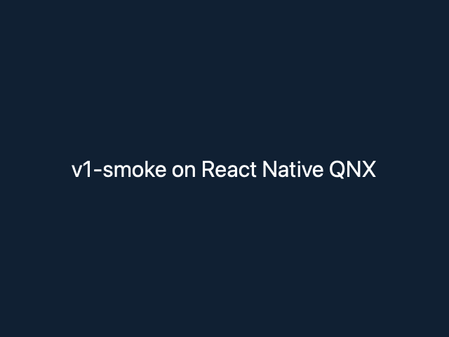
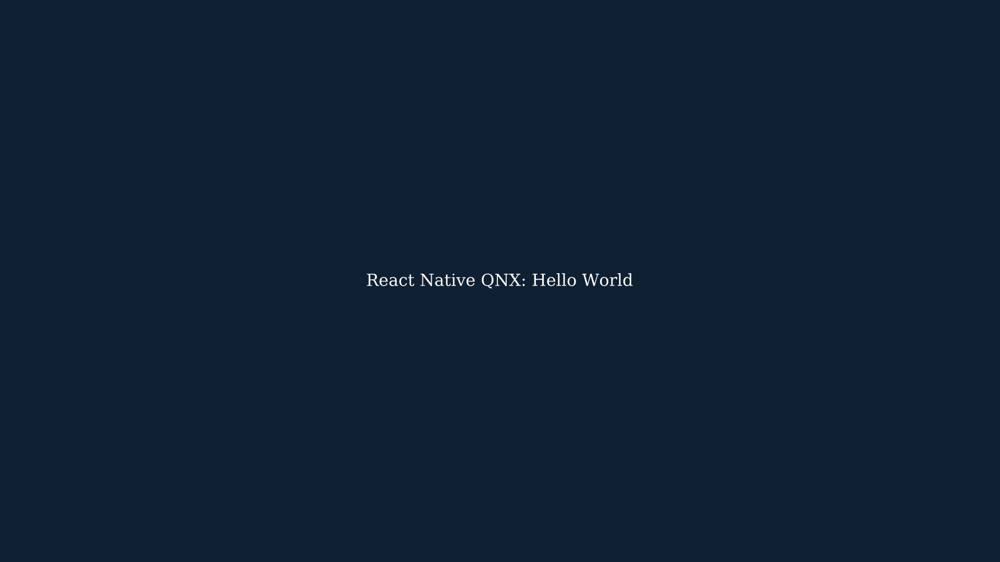

# Evidence gallery

Every receipt in [`docs/evidence/`](../evidence/), sorted by the machine it ran
on. A receipt that covers a host run and a device run appears in both tables;
each row states only what ran on that table's target. A host result never
counts toward a device column.

All receipts below are dated 2026-11-06 or 2026-11-07 and record the candidate
revision named inside them. None was rerun for this page. They are historical
prerequisite evidence and have not been attached to any v1 gate in
[v1-readiness.json](../releases/v1-readiness.json).

| Target                       | What that target means here                                                  |
| ---------------------------- | ---------------------------------------------------------------------------- |
| Development host             | macOS arm64 unless the row says otherwise; Linux container runs are labelled |
| Pi 400, custom BCM2711 image | Physical Pi 400, QNX SDP 8.0.5, Qt 6.12.0 evaluation build, run as `qnxuser` |
| Stock Pi 4, QSTI             | QSTI 0.5.0 build 50, the stock release board for v1. No receipts yet         |

## Development host

| Receipt                                                                                                       | What ran                                                                                                                                                      | Result as recorded                                                                                   |
| ------------------------------------------------------------------------------------------------------------- | ------------------------------------------------------------------------------------------------------------------------------------------------------------- | ---------------------------------------------------------------------------------------------------- |
| [V1 preparation](../evidence/v1-polish-host-2026-11-07.md) ([log](../evidence/v1-polish-host-2026-11-07.log)) | CLI `init`, bundle and host render; dependency, type, JS and docs checks                                                                                      | Passed, including 21 JS test modules; one failed build attempt is recorded in the receipt            |
| [Pi 400 follow-up, host part](../evidence/pi400-host-validation-2026-11-07.md)                                | Full macOS host graph: Hermes, React/Fabric rendering, viewport and lifecycle regressions                                                                     | 11/11 CTests after two fixes described in the receipt                                                |
| [Host mounting benchmark data](../evidence/pi400-host-mounting-2026-11-07.json)                               | macOS 27 arm64, Apple clang 21, Qt 6.12.0, MinSizeRel, unsanitized                                                                                            | Raw numbers only; the file name says Pi 400 but the platform field is macOS                          |
| [Pressable responder, host part](../evidence/pressable-qnx-2026-11-07.md)                                     | Production-Metro Pressable fixture in fresh host graphs                                                                                                       | 23/23 with input and tracing ON; 16/16 with both OFF                                                 |
| [Runtime trace, host part](../evidence/pi400-runtime-trace-2026-11-07.md)                                     | Bounded native trace recorder                                                                                                                                 | 20/20 ON, 18/18 OFF, then 4/4 focused queue-correlation tests; Ubuntu amd64 container 2/2 standalone |
| [View accessibility, host part](../evidence/accessibility-view-qnx-2026-11-07.md)                             | Semantic-query fixture with ASan/UBSan; full suites                                                                                                           | Fixture 1/1; 27/27 all options ON; 16/16 all options OFF                                             |
| [View activation, host part](../evidence/accessibility-action-qnx-2026-11-07.md)                              | Accessibility `activate` action through to the React callback                                                                                                 | Host probes and full host suite passed after a prop/event boundary fix                               |
| [TextInput receipts, host parts](../evidence/text-input-qnx-2026-11-07.md)                                    | Edit contract, [keyboard traversal](../evidence/text-input-focus-qnx-2026-11-07.md), [read-only blur](../evidence/text-input-readonly-blur-qnx-2026-11-07.md) | Host checks passed for each candidate; counts are in each receipt                                    |
| [Systems probes, host parts](../evidence/qnx-systems-probes-2026-11-07.md)                                    | Standalone probe on macOS (ASan/UBSan) and in an Ubuntu 24.04 amd64 container                                                                                 | macOS 3 tests × 10 runs passed; Linux 3/3. The Linux run is not a Marathon result                    |

Also host-side: the [Reanimated/Worklets source audit](../evidence/qnx-animation-source-audit-2026-11-07.json),
a package source inspection with no runtime claim.

The host render from the V1 preparation receipt: an app created with
`pnpm qnx init`, bundled, and drawn by the macOS host playground.

## Pi 400, custom BCM2711 image

| Receipt                                                                                                                               | What ran                                                                                                                                                      | Result as recorded                                                                                                                                                                        |
| ------------------------------------------------------------------------------------------------------------------------------------- | ------------------------------------------------------------------------------------------------------------------------------------------------------------- | ----------------------------------------------------------------------------------------------------------------------------------------------------------------------------------------- |
| [Hermes and C++20 probe](../evidence/pi400-hermes-2026-11-06.txt)                                                                     | Hermes stack and bytecode markers; C++20 feature probe                                                                                                        | Markers printed, SSH exit 0; `std::jthread` unsupported in this SDP's libc++. The receipt does not name the board; the Pi 400 attribution comes from its file name and the session record |
| [Qt and folly](../evidence/pi400-qt-folly-2026-11-07.txt)                                                                             | Standalone Qt Quick window as `qnxuser`; Folly probe printed `RNQNX_FOLLY_QNX_OK`; native socket batching unverified                                          | Window created, exit 0; 640×480 capture checked by eye                                                                                                                                    |
| [Hello World](../evidence/pi400-hello-world-2026-11-07.txt)                                                                           | Production Metro bundle through Fabric, Hermes and Qt Quick, with a synchronous Nitro v1 call                                                                 | `RNQNX_HELLO_NITRO_V1_OK ... add=42`; fullscreen 1920×1080 capture                                                                                                                        |
| [Qt/Nitro dispatcher](../evidence/pi400-nitro-qt-2026-11-07.md) ([artifacts](../evidence/pi400-nitro-qt-artifacts-2026-11-07.json))   | Opt-in Qt dispatcher: callbacks, Promises, errors, teardown races                                                                                             | Passed on the device; no general QNX Nitrogen support implied                                                                                                                             |
| [Runtime baseline](../evidence/pi400-runtime-baseline-2026-11-07.md) ([data](../evidence/pi400-runtime-baseline-2026-11-07.json))     | Ten supervised fullscreen app launches with failure controls                                                                                                  | All ten exited zero with the Nitro marker and a full 1920×1080 PNG. Launches, not cold boots                                                                                              |
| [Runtime trace, device part](../evidence/pi400-runtime-trace-2026-11-07.md) ([data](../evidence/pi400-runtime-trace-2026-11-07.json)) | Trace export, protected-file failure, OFF-path capture                                                                                                        | Passed; no tracing-overhead or performance figure                                                                                                                                         |
| [Fabric input to JavaScript](../evidence/pi400-input-js-2026-11-07.md) ([data](../evidence/pi400-input-js-2026-11-07.json))           | Synthetic Qt input reaching raw Fabric JS callbacks                                                                                                           | Callbacks delivered; interception control failed as intended. No USB keyboard or touch                                                                                                    |
| [Input lifecycle capture](../evidence/pi400-input-lifecycle-2026-11-07.json)                                                          | Data and screenshot for the [input lifecycle validation](../validation/qt-input-lifecycle-2026-11-07.md)                                                      | Synthetic input only                                                                                                                                                                      |
| [Pressable responder, device part](../evidence/pressable-qnx-2026-11-07.md)                                                           | Synthetic input through the production Pressable path, remount recovery, failure controls                                                                     | Passed with the RN patch; remount failure reproduces with only that patch disabled                                                                                                        |
| [View accessibility, device part](../evidence/accessibility-view-qnx-2026-11-07.md)                                                   | Bounded semantic-query trials                                                                                                                                 | Passed; not full React Native accessibility                                                                                                                                               |
| [View activation, device part](../evidence/accessibility-action-qnx-2026-11-07.md)                                                    | Six physical QNX gates for the `activate` action                                                                                                              | Passed                                                                                                                                                                                    |
| [TextInput receipts, device parts](../evidence/text-input-qnx-2026-11-07.md)                                                          | Edit contract, [keyboard traversal](../evidence/text-input-focus-qnx-2026-11-07.md), [read-only blur](../evidence/text-input-readonly-blur-qnx-2026-11-07.md) | Device trials passed for each candidate; no IME                                                                                                                                           |
| [Systems probes, device part](../evidence/qnx-systems-probes-2026-11-07.md)                                                           | Positive, TLS-fault, EOF-fault and positive runs under a 10-second supervisor                                                                                 | Exits 0, 1, 1, 0 as expected                                                                                                                                                              |
| [Forge seam](../evidence/forge-qnx-2026-11-07.md)                                                                                     | Optional licensed Forge engine, experimental source-built Rust std                                                                                            | Passed as recorded; Forge is not a platform dependency or a release gate                                                                                                                  |

The fullscreen Hello World capture from the Pi 400. The
[640×480 capture](../evidence/pi400-hello-world-2026-11-07.png),
[Nitro/Qt capture](../evidence/pi400-nitro-qt-hello-world-2026-11-07.png) and
[input lifecycle capture](../evidence/pi400-input-lifecycle-2026-11-07.png) show
the same screen.

## Stock Pi 4, QSTI

| Area                         | Status  |
| ---------------------------- | ------- |
| Hello World runtime          | not run |
| Component dispositions       | not run |
| Keyboard and touch input     | not run |
| Graphics cold boot (20 runs) | not run |
| Performance measurements     | not run |

No receipt exists for this target. The
[component support table](../component-support.md) shows `unverified` for every
component in its Pi 4 QSTI column. Pi 400 results do not carry over: the board,
image and graphics stack differ. The `device-parity`, `cold-boot` and
`performance` gates need receipts here.

## Add a receipt

Put the file in `docs/evidence/` with the target and date in its name. State the
board, image, revision, command and observed result inside it. Then add one row
to the table for each target it ran on, and keep host and device results in
separate rows.
