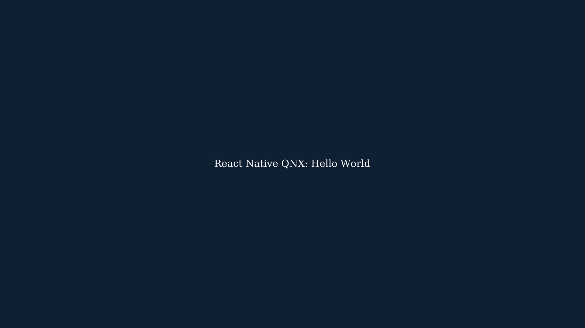

# Evidence gallery

Every receipt in [`docs/evidence/`](../evidence/) is listed on this page, grouped by the machine it ran on:
the development host, the QNX VM, the custom Pi 400 image and stock Pi 4 QSTI. The first set of tables
covers the 2026-11-06 and 2026-11-07 receipts in detail. The sections under
[Later receipts](#later-receipts-2026-11-12-to-2026-11-21) cover everything dated 2026-11-12 or later.
A receipt that covers a host run and a device run appears in both tables; each row states only what ran
on that table's target. A host result never counts toward a device column, and a QNX VM result never
counts toward a Pi 400 or release-board column.

Each receipt records the revision it ran on. None was rerun for this page. [v1-readiness.json](../releases/v1-readiness.json)
cites the `dependencies` receipt (gate passed) and two `window-chrome` receipts (gate still pending); no other receipt is attached to a gate. The 2026-11-06 and
2026-11-07 Hello World and Nitro receipts ran Nitro `1.0.0-alpha.nightly.105.g69d365fc9b18`; the pin on `main`
is `alpha.nightly.136.gdb81de61bd32`, and the Nitro device result was not rerun on it.

| Target                       | What that target means here                                                                                                                                                    |
| ---------------------------- | ------------------------------------------------------------------------------------------------------------------------------------------------------------------------------ |
| Development host             | macOS arm64 unless the row says otherwise; Linux container runs are labelled                                                                                                   |
| QNX VM                       | QEMU 11.1.3 on the Mac, QNX SDP 8.0.5, software render, TCG emulation. Not a board: timings are not performance evidence and no row counts as Pi 400 or release-board evidence |
| Pi 400, custom BCM2711 image | Physical Pi 400, QNX SDP 8.0.5, Qt 6.12.0 evaluation build (expired 2026-11-17) for the 2026-11-06/07 rows; public-source Qt from 2026-11-12 onward, run as `qnxuser`          |
| Stock Pi 4, QSTI             | QSTI 0.5.0 build 50, the stock release board for v1. No receipts yet                                                                                                           |

## Development host

| Receipt                                                                                                       | What ran                                                                                                                                                      | Result as recorded                                                                                   |
| ------------------------------------------------------------------------------------------------------------- | ------------------------------------------------------------------------------------------------------------------------------------------------------------- | ---------------------------------------------------------------------------------------------------- |
| [V1 preparation](../evidence/v1-polish-host-2026-11-07.md) ([log](../evidence/v1-polish-host-2026-11-07.log)) | CLI `init`, bundle and host render; dependency, type, JS and docs checks                                                                                      | Passed, including 21 JS test modules; one failed build attempt is recorded in the receipt            |
| [Pi 400 follow-up, host part](../evidence/pi400-host-validation-2026-11-07.md)                                | Full macOS host graph: Hermes, React/Fabric rendering, viewport and lifecycle regressions                                                                     | 11/11 CTests after two fixes described in the receipt                                                |
| [Host mounting benchmark data](../evidence/pi400-host-mounting-2026-11-07.json)                               | macOS 27 arm64, Apple clang 21, Qt 6.12.0, MinSizeRel, unsanitized                                                                                            | Raw numbers only; the file name says Pi 400 but the platform field is macOS                          |
| [Pressable responder, host part](../evidence/pressable-qnx-2026-11-07.md)                                     | Production-Metro Pressable fixture in fresh host graphs                                                                                                       | 23/23 with input and tracing ON; 16/16 with both OFF                                                 |
| [Runtime trace, host part](../evidence/pi400-runtime-trace-2026-11-07.md)                                     | Bounded native trace recorder                                                                                                                                 | 20/20 ON, 18/18 OFF, then 4/4 focused queue-correlation tests; Ubuntu amd64 container 2/2 standalone |
| [View accessibility, host part](../evidence/accessibility-view-qnx-2026-11-07.md)                             | Semantic-query fixture with ASan/UBSan; full suites                                                                                                           | Fixture 1/1; 27/27 all options ON; 16/16 all options OFF                                             |
| [View activation, host part](../evidence/accessibility-action-qnx-2026-11-07.md)                              | Accessibility `activate` action through to the React callback                                                                                                 | Host probes and full host suite passed after a prop/event boundary fix                               |
| [TextInput receipts, host parts](../evidence/text-input-qnx-2026-11-07.md)                                    | Edit contract, [keyboard traversal](../evidence/text-input-focus-qnx-2026-11-07.md), [read-only blur](../evidence/text-input-readonly-blur-qnx-2026-11-07.md) | Host checks passed for each candidate; counts are in each receipt                                    |
| [Systems probes, host parts](../evidence/qnx-systems-probes-2026-11-07.md)                                    | Standalone probe on macOS (ASan/UBSan) and in an Ubuntu 24.04 amd64 container                                                                                 | macOS 3 tests × 10 runs passed; Linux 3/3. The Linux run is not a Marathon result                    |

Also host-side: the [Reanimated/Worklets source audit](../evidence/qnx-animation-source-audit-2026-11-07.json),
a package source inspection with no runtime claim.

The host render from the V1 preparation receipt: an app created with
`pnpm qnx init`, bundled, and drawn by the macOS host playground.

## Pi 400, custom BCM2711 image

| Receipt                                                                                                                               | What ran                                                                                                                                                      | Result as recorded                                                                                                                                                                        |
| ------------------------------------------------------------------------------------------------------------------------------------- | ------------------------------------------------------------------------------------------------------------------------------------------------------------- | ----------------------------------------------------------------------------------------------------------------------------------------------------------------------------------------- |
| [Hermes and C++20 probe](../evidence/pi400-hermes-2026-11-06.txt)                                                                     | Hermes stack and bytecode markers; C++20 feature probe                                                                                                        | Markers printed, SSH exit 0; `std::jthread` unsupported in this SDP's libc++. The receipt does not name the board; the Pi 400 attribution comes from its file name and the session record |
| [Qt and folly](../evidence/pi400-qt-folly-2026-11-07.txt)                                                                             | Standalone Qt Quick window as `qnxuser`; Folly probe printed `RNQNX_FOLLY_QNX_OK`; native socket batching unverified                                          | Window created, exit 0; 640×480 capture checked by eye                                                                                                                                    |
| [Hello World](../evidence/pi400-hello-world-2026-11-07.txt)                                                                           | Production Metro bundle through Fabric, Hermes and Qt Quick, with a synchronous Nitro v1 call                                                                 | `RNQNX_HELLO_NITRO_V1_OK ... add=42`; fullscreen 1920×1080 capture                                                                                                                        |
| [Qt/Nitro dispatcher](../evidence/pi400-nitro-qt-2026-11-07.md) ([artifacts](../evidence/pi400-nitro-qt-artifacts-2026-11-07.json))   | Opt-in Qt dispatcher: callbacks, Promises, errors, teardown races                                                                                             | Passed on the device; no general QNX Nitrogen support implied                                                                                                                             |
| [Runtime baseline](../evidence/pi400-runtime-baseline-2026-11-07.md) ([data](../evidence/pi400-runtime-baseline-2026-11-07.json))     | Ten supervised fullscreen app launches with failure controls                                                                                                  | All ten exited zero with the Nitro marker and a full 1920×1080 PNG. Launches, not cold boots                                                                                              |
| [Runtime trace, device part](../evidence/pi400-runtime-trace-2026-11-07.md) ([data](../evidence/pi400-runtime-trace-2026-11-07.json)) | Trace export, protected-file failure, OFF-path capture                                                                                                        | Passed; no tracing-overhead or performance figure                                                                                                                                         |
| [Fabric input to JavaScript](../evidence/pi400-input-js-2026-11-07.md) ([data](../evidence/pi400-input-js-2026-11-07.json))           | Synthetic Qt input reaching raw Fabric JS callbacks                                                                                                           | Callbacks delivered; interception control failed as intended. No USB keyboard or touch                                                                                                    |
| [Input lifecycle capture](../evidence/pi400-input-lifecycle-2026-11-07.json)                                                          | Data and screenshot for the [input lifecycle validation](../validation/qt-input-lifecycle-2026-11-07.md)                                                      | Synthetic input only                                                                                                                                                                      |
| [Pressable responder, device part](../evidence/pressable-qnx-2026-11-07.md)                                                           | Synthetic input through the production Pressable path, remount recovery, failure controls                                                                     | Passed with the RN patch; remount failure reproduces with only that patch disabled                                                                                                        |
| [View accessibility, device part](../evidence/accessibility-view-qnx-2026-11-07.md)                                                   | Bounded semantic-query trials                                                                                                                                 | Passed; not full React Native accessibility                                                                                                                                               |
| [View activation, device part](../evidence/accessibility-action-qnx-2026-11-07.md)                                                    | Six physical QNX gates for the `activate` action                                                                                                              | Passed                                                                                                                                                                                    |
| [TextInput receipts, device parts](../evidence/text-input-qnx-2026-11-07.md)                                                          | Edit contract, [keyboard traversal](../evidence/text-input-focus-qnx-2026-11-07.md), [read-only blur](../evidence/text-input-readonly-blur-qnx-2026-11-07.md) | Device trials passed for each candidate; no IME                                                                                                                                           |
| [Systems probes, device part](../evidence/qnx-systems-probes-2026-11-07.md)                                                           | Positive, TLS-fault, EOF-fault and positive runs under a 10-second supervisor                                                                                 | Exits 0, 1, 1, 0 as expected                                                                                                                                                              |
| [Forge seam](../evidence/forge-qnx-2026-11-07.md)                                                                                     | Optional licensed Forge engine, experimental source-built Rust std                                                                                            | Passed as recorded; Forge is not a platform dependency or a release gate                                                                                                                  |

The fullscreen Hello World capture from the Pi 400. The
[640×480 capture](../evidence/pi400-hello-world-2026-11-07.png),
[Nitro/Qt capture](../evidence/pi400-nitro-qt-hello-world-2026-11-07.png) and
[input lifecycle capture](../evidence/pi400-input-lifecycle-2026-11-07.png) show
the same screen.

## Later receipts (2026-11-12 to 2026-11-21)

These receipts were added after the tables above. Each row names the target that its own README states and the
limit that README states. Nothing here is stock Pi 4 QSTI or release-board evidence.

### Development host and hosted runners

| Receipt                                                                                                                                                                                                                   | What ran                                                                                                                                                                                                     | Limit stated in the receipt                                                                             |
| ------------------------------------------------------------------------------------------------------------------------------------------------------------------------------------------------------------------------- | ------------------------------------------------------------------------------------------------------------------------------------------------------------------------------------------------------------ | ------------------------------------------------------------------------------------------------------- |
| [Clean-host simulation, 2026-11-12](../evidence/clean-host-sim-2026-11-12-b51b49c.md)                                                                                                                                     | Fresh clone and empty `HOME` on a used Mac                                                                                                                                                                   | A simulation: the Mac already had Homebrew, Node, Qt and the SDP, so it is not a clean machine          |
| [Package contents audit, 2026-11-12](../evidence/pack-contents-2026-11-12-b51b49c.md)                                                                                                                                     | `pnpm pack` in every non-private package, then listing                                                                                                                                                       | Nothing was published                                                                                   |
| [Quick start host render, 2026-11-19](../evidence/quickstart-host-2026-11-19.md)                                                                                                                                          | The README quick start commands on a fresh clone                                                                                                                                                             | No board, no container                                                                                  |
| [Gallery layout through Yoga, 2026-11-13](../evidence/gallery-yoga-layout-2026-11-13.md)                                                                                                                                  | A JS test that feeds `onLayout` back through `yoga-layout` 3.2.1 for the gallery routes                                                                                                                      | Layout only; no pixels                                                                                  |
| [Router option audit, 2026-11-13](../evidence/router-prop-audit-2026-11-13.md)                                                                                                                                            | Source reading of `Tabs` and `Drawer` options in `expo-router` 58.0.31                                                                                                                                       | A source audit, no runtime claim                                                                        |
| [Hermes build hygiene, 2026-11-20](../evidence/hermes-build-hygiene-2026-11-20.md)                                                                                                                                        | Hermes build configuration and timing on one Mac                                                                                                                                                             | Other lanes shared the machine, so wall times carry noise                                               |
| [Performance budgets, 2026-11-20](../evidence/s4-budgets-2026-11-20/README.md)                                                                                                                                            | Budget file, validator, host lane and timing probe                                                                                                                                                           | Nothing measured on the VM, the Pi 400 or the release board; `performance` stays pending                |
| [Expo gate slice, 2026-11-20](../evidence/expo-gate-2026-11-20/README.md)                                                                                                                                                 | Prebuild idempotence test and the Expo SDK 58 capability table generator                                                                                                                                     | `expo` stays pending                                                                                    |
| [Runner analyze, pack and check, 2026-11-20](../evidence/s6-runner-2026-11-20/README.md)                                                                                                                                  | `rnqnx analyze`, `runner pack`, `runner check` with five mutation checks, against a macOS arm64 runner                                                                                                       | No QNX runner was built; nothing was published                                                          |
| [JavaScript thread, host, 2026-11-21](../evidence/s2-js-thread-2026-11-21/README.md)                                                                                                                                      | ASan build and tests for the opt-in JavaScript thread                                                                                                                                                        | Host only; the VM receipt below extends it                                                              |
| [Window chrome, host, 2026-11-21](../evidence/s8-app-identity-window-chrome-2026-11-21/README.md)                                                                                                                         | Layout switch, title-bar inset model and contrast fixes under the offscreen QPA                                                                                                                              | `window-chrome` and `app-identity` stay pending                                                         |
| [Dependencies re-check, 2026-11-21](../evidence/dependencies-2026-11-21/README.md)                                                                                                                                        | Dependency validation, audit and `pnpm outdated -r` on `fb20c3ad`, host and GitHub-hosted                                                                                                                    | Cited by the `dependencies` gate, which is passed                                                       |
| [Distribution, host and container parts, 2026-11-21](../evidence/distribution-2026-11-21/README.md)                                                                                                                       | Qt source identity, patch and configure reproduction, qtimageformats build, closure check script                                                                                                             | `distribution` stays pending: Qt core libraries were not rebuilt, and no source offer or package exists |
| PR 149, 159 and 161 Linux host receipts, [PR 149](../validation/pr149-stack-integration-2026-11-16.md), [PR 159](../validation/pr159-review-followup-2026-11-14.md), [PR 161](../validation/pr161-geometry-2026-11-16.md) | Worklets, Reanimated, Gesture Handler, image fetcher and SVG layout host tests with negative controls; raw outputs sit in the `pr149-*`, `pr159-*` and `pr161-*` folders of [`docs/evidence/`](../evidence/) | Linux host evidence; the PR 159 receipt says it contains no QNX or physical-device result               |

### QNX VM

QEMU 11.1.3, TCG, software render. Timings from these runs are not performance evidence.

| Receipt                                                                              | What ran                                                                                           | Limit stated in the receipt                                                        |
| ------------------------------------------------------------------------------------ | -------------------------------------------------------------------------------------------------- | ---------------------------------------------------------------------------------- |
| [Component captures, 2026-11-20](../evidence/qnx-vm-2026-11-20/README.md)            | Twelve component cards rendered by the showcase app and captured with `--screenshot`               | Render only; five cards failed on the public entry, which the next row re-captured |
| [Re-capture of five components, 2026-11-21](../evidence/qnx-vm-2026-11-21/README.md) | The five cards that failed, on the fixed public entry; all five exited 0                           | Render only; nothing pressed or scrolled                                           |
| [VM validation lane, 2026-11-21](../evidence/s5-vm-lane-2026-11-21/README.md)        | `scripts/validate-qnx-vm.sh` three times plus a staged-copy run, all passing                       | Not the Pi 400 and not the release board; no budget changes                        |
| [JavaScript thread on the VM, 2026-11-21](../evidence/s2-vm-2026-11-21/README.md)    | A native pan, minimize and close controls, and a 5 s blocked JS thread, three runs of 11 cases     | Synthetic `QMouseEvent`s; the showcase app was not used; not Gesture Handler       |
| [Runner preflight, 2026-11-21](../evidence/s6-preflight-2026-11-21/README.md)        | The preflight unit test, cross-built and run on the VM, beside the host run                        | No playground host or app ran on the VM                                            |
| [Distribution, VM part, 2026-11-21](../evidence/distribution-2026-11-21/README.md)   | All 26 ELF files of the staged runtime load on the VM; the gallery app ran after the RPATH rewrite | See the host row for what stays open                                               |

A Linux VM receipt also exists, [Marathon VM run, 2026-11-20](../evidence/marathon-vm-2026-11-20/README.md).
It is a Lima VM on a Mac with software rendering and is not QNX evidence; Marathon is outside the v1 scope.

### Pi 400, custom BCM2711 image

| Receipt                                                                                                                                                                                         | What ran                                                                                                                          | Limit stated in the receipt                                                                                              |
| ----------------------------------------------------------------------------------------------------------------------------------------------------------------------------------------------- | --------------------------------------------------------------------------------------------------------------------------------- | ------------------------------------------------------------------------------------------------------------------------ |
| [Public-source Qt, 2026-11-12](../evidence/pi400-public-qt-2026-11-12-b51b49c.md) and [at -O2](../evidence/pi400-public-qt-o2-2026-11-12-a79e16a.md)                                            | Hello World, the Qt/Nitro dispatcher probe and the Pressable probe with only public-source Qt loaded; then the `-O2` runtime      | The `-O2` runtime is the one the component gallery uses                                                                  |
| [Qt Multimedia and QtVideo, 2026-11-13](../evidence/media-2026-11-13.md)                                                                                                                        | A QtVideo run with the multimedia add-on                                                                                          | Off by default; control-bar taps and fullscreen were not run and audio was not heard                                     |
| [Image format plugins, 2026-11-13](../evidence/pi-image-formats-2026-11-13.md)                                                                                                                  | Animated GIF and WebP through `expo-image`                                                                                        | GIF played; WebP did not until the plugin build step was added, which the receipt then proves on the device              |
| [Development client, 2026-11-13](../evidence/pi400-dev-client-2026-11-13/README.md)                                                                                                             | Fast Refresh, LogBox, developer menu and Metro-unreachable screen                                                                 | Input injected through Screen; pointer injection did not reach the right coordinates                                     |
| [Gallery layout, 2026-11-13](../evidence/tile-layout-pi400-2026-11-13/README.md)                                                                                                                | Component gallery at three window sizes and one live resize                                                                       | Its own review says the host identity, revision and commands were not recorded, so it cannot qualify a candidate         |
| [PR 149 run 1](../evidence/pr149-pi400-run1-2026-11-19/README.md), [run 2](../evidence/pr149-pi400-run2-2026-11-19/README.md), [held key](../evidence/pr149-pi400-keyhold-2026-11-19/README.md) | Worklets, Reanimated, Gesture Handler pan, tap and double-tap, SVG, `expo-image`, modal and drawer Escape, key repeat at 1024x768 | No pinch, rotation, multi-pointer, 1920x1080, Video, Audio or JS-blocked gesture; key repeat was synthetic Screen events |

Several 2026-11-13 folders hold raw captures and logs and no README: `drawer-route-`, `drawer-runtime-`,
`drawer-selection-`, `expo-image-device-`, `expo-image-io-`, `expo-image-resize-`, `svg-device-`,
`worklets-frame-`, `rnsvg-corpus-` and `window-chrome-host-2026-11-12`. Read them through the write-ups in
[`docs/validation/`](../validation/) (for example [drawer selection](../validation/pr159-drawer-selection-2026-11-13.md)
and [SVG gallery](../validation/pr161-device-gallery-2026-11-13.md)). The folders themselves do not state a board,
so this page does not assign them to a column. [`webgpu-qnx-2026-11-13`](../evidence/webgpu-qnx-2026-11-13/) belongs to the v2 research track and is outside v1.

## Stock Pi 4, QSTI

| Area                         | Status  |
| ---------------------------- | ------- |
| Hello World runtime          | not run |
| Component dispositions       | not run |
| Keyboard and touch input     | not run |
| Graphics cold boot (20 runs) | not run |
| Performance measurements     | not run |

No receipt exists for this target. The
[component support table](../component-support.md) shows `unverified` for every
component in its Pi 4 QSTI column. Pi 400 results do not carry over: the board,
image and graphics stack differ. The `device-parity`, `cold-boot` and
`performance` gates need receipts here.

## Add a receipt

Put the file in `docs/evidence/` with the target and date in its name. State the
board, image, revision, command and observed result inside it. Then add one row
to the table for each target it ran on, and keep host and device results in
separate rows.
