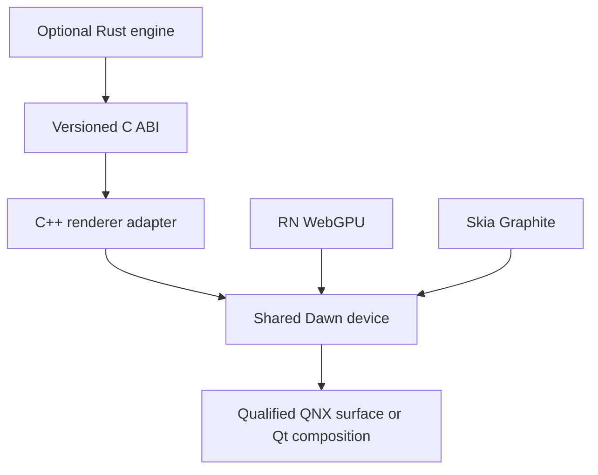

# V2 graphics backends and native surface contract

Reviewed on 2026-11-10. The existing Fabric → Yoga → Qt Quick renderer remains
the platform renderer. This document distinguishes the native foundation in
this branch from adapters that still need implementation and target evidence.

## Implemented foundation

`RNQNX_ENABLE_QT_GRAPHICS=ON` builds the default-OFF `rnqnx_qt_graphics` library
from [`native/qt/graphics`](../../native/qt/graphics). Its public C++
`QtGraphicsSurface` observes one existing `QQuickWindow`; it does not create a
GPU device, render target, WebGPU implementation, or JavaScript API.

The version-1 value snapshot contains:

- Scene-graph state: `Uninitialized`, `Initialized`, `Invalidated`, `Destroyed`,
  or explicitly `Closed` observation.
- The selected Qt backend, including distinct `Unknown`, `Software`, `OpenGL`,
  `Vulkan`, `Metal`, Direct3D, OpenVG and null-renderer values. Backend is
  `Unknown` outside the initialized state.
- Logical and pixel dimensions, effective DPR, visibility and exposure.
  Pixel dimensions round to the nearest integer. The conversion rejects
  negative dimensions, non-positive/non-finite DPR and integer overflow.
- A generation that invalidates on scene-graph, native-surface and viewport
  transitions, plus a separate observation sequence.

These are observations of Qt, not feature flags for external libraries. In
particular, `OpenGL` does not establish an OpenGL ES version, compute support,
WebGPU compatibility, or texture sharing. A hidden window may retain an
initialized scene graph. The software backend can initialize before `show()`;
visibility, exposure and initialization are separate facts.

Construction, reading, cleanup and signal delivery belong to the GUI owner.
Scene-graph and `frameSwapped` notifications are queued to that owner. A frame
record includes a monotonically increasing sequence and the monotonic time
when the owner processes the notification. It is **not** a render clock,
presentation timestamp, GPU completion fence, deadline, or Worklets scheduler.
An idle/hidden window is not promised to emit frames. The observer neither
starts a timer nor requests extra rendering. These boundaries follow the
[QQuickWindow signal and resource contract](https://doc.qt.io/qt-6/qquickwindow.html).

Connect before reading the initial snapshot. Disconnect the returned Qt
connection when the consumer ends, or close the entire observation:

```cpp
rnqnx::graphics::QtGraphicsSurface graphics(window);
const auto subscription = QObject::connect(
    &graphics, &rnqnx::graphics::QtGraphicsSurface::snapshotChanged,
    &consumer, [](rnqnx::graphics::GraphicsSurfaceSnapshot state) {
      // Cache/report the observed state; do not retain a native GPU pointer.
    });
const auto initial = graphics.snapshot();
// ... use initial and subsequent snapshots on the GUI owner ...
QObject::disconnect(subscription);
graphics.close();  // idempotent; late queued observations are ignored
```

Window destruction produces a terminal `Destroyed` snapshot. The observer
does not own the window. Create another observer for another window. Calling
its methods from a worker throws `std::logic_error`; a future Nitro binding
must use the existing runtime owner instead of synchronously hopping threads.
The native test exercises deletion and closure during callback delivery.

Only public Qt Core/Gui/Quick interfaces are used. There are no private
headers, `QRhi` dependencies, or raw GPU handles exposed to JavaScript.

## Engines and adapters are separate work

| Consumer             | Actual rendering contract                                                                     | QNX work still required                                                                                                                                    |
| -------------------- | --------------------------------------------------------------------------------------------- | ---------------------------------------------------------------------------------------------------------------------------------------------------------- |
| React Native WebGPU  | Its native JSI/Canvas implementation over Dawn, with WGSL shaders                             | Dawn/Tint target build, supported driver/backend, QNX surface or Qt composition path, platform context, runtime installation, frame ownership and teardown |
| TypeGPU              | Typed resource/shader layer that consumes WebGPU                                              | A working RN WebGPU adapter and its required features/limits; validate render and compute workloads independently                                          |
| React Native Skia v3 | Skia Graphite, sharing the selected Dawn build with RN WebGPU on supported upstream platforms | Skia native platform context, font/image/assets, render surface, resource lifetime, matching Dawn and actual target execution                              |
| Three.js             | Its `WebGPURenderer` over the WebGPU device/context, or its separate WebGL renderer           | Real graphics adapter, renderer bootstrap, assets/loaders, input, resize, manual native presentation and cleanup                                           |
| Qt Quick 3D          | Qt's `View3D` scene, models, materials, cameras and picking inside Qt Quick                   | An optional native scene/component adapter and device qualification; this does not implement the Three.js API                                              |

[RN WebGPU](https://wcandillon.github.io/react-native-webgpu/) does not list QNX
as an upstream target. Its inspected
[`WebGPURuntime::makeSurface`](https://github.com/wcandillon/react-native-webgpu/blob/c6eca4c70b941e8338672bd3c6c2ee32081e13fc/packages/webgpu/cpp/rnwgpu/WebGPURuntime.cpp)
selects an Android native window under `__ANDROID__` and otherwise a Metal
layer. Passing a QNX `screen_window_t` into that path is not a QNX port.
Its [`PlatformContext`](https://github.com/wcandillon/react-native-webgpu/blob/c6eca4c70b941e8338672bd3c6c2ee32081e13fc/packages/webgpu/cpp/rnwgpu/PlatformContext.h)
also needs actual image decoding, native window ownership and snapshot
services. Callback completion must return through the runtime's owned queue.

[RN WebGPU's native API](https://wcandillon.github.io/react-native-webgpu/docs/getting-started/native-api)
supports installation on individual worklet runtimes. One canvas has one
rendering runtime; command encoders are not shareable between threads. Its
current native-window helper describes Android and Apple surfaces, not QNX.
Base WebGPU validation can begin on the RN runtime before off-thread Worklets
rendering is qualified.

The current [Skia/WebGPU integration](https://wcandillon.github.io/react-native-webgpu/docs/integrations/react-native-skia)
requires one compatible `react-native-webgpu-dawn` library. The inspected
compatibility table pairs RN WebGPU 0.20.0+ with RN Skia 3.9.0+. These are
upstream compatibility observations, not dependencies installed by this slice.
Skia supplies its native device for WebGPU import; Skia does not itself
install `navigator.gpu`. The
[Skia v3 repository](https://github.com/wcandillon/react-native-skia) now uses
the `react-native-skia` package and Graphite; its maintained v2/Ganesh path is
a different integration. Pin an exact matching package/native closure before
starting either implementation.

[TypeGPU's Worklets integration](https://docs.swmansion.com/TypeGPU/integration/react-native/worklets/)
also needs the Babel/Metro Bundle Mode setup and appropriate transfer rules.
A proof that an isolated worklet executes Hermes bytecode does not prove that
this module-loading/transfer path works. Shader definitions, encoders and
attachment-bound pipelines have distinct restrictions. TypeGPU does not turn
Qt shaders or an OpenGL context into a WebGPU implementation.

[Three.js's RN WebGPU integration](https://wcandillon.github.io/react-native-webgpu/docs/integrations/three-js)
uses `three/webgpu`, a matching device/context, asset-loader support and
`context.present()` after native rendering. It also needs renderer disposal,
animation-loop shutdown and correct DPR. Browser-only fallback behavior does
not supply a native QNX WebGL implementation. React Three Fiber, if selected,
needs its own integration evidence above this renderer.

## Reusing an existing Rust engine

The optional consuming-app Forge audit at
`a70e433d53a1bff81c27b747e9b2de7b1722ba64` found a Rust document/algorithm engine
behind a C ABI, including a CPU RGBA compositor; it did not find an existing
`wgpu`, Skia or Dawn GPU backend. That engine can still be useful. Reuse its
document state, commands, tessellation or computed buffers, then add a renderer
adapter in the licensed package/consuming app. Do not move premium source into
this platform or make it a platform dependency.

The proposed first adapter is:



Keep ownership and cancellation on the native side. Rust can submit a typed
command/buffer description through a narrow ABI while C++ owns Dawn objects,
render-thread access and completion. CPU output initially requires a defined
buffer transfer and GPU upload. Avoid repeatedly serializing full documents or
pixel buffers through JavaScript just to reach the same native process.
Measure copies before claiming any transfer is zero-copy.

Direct Rust bindings to the **same pinned Dawn C API** are another possible
later adapter. Dawn exposes [`webgpu.h`](https://dawn.googlesource.com/dawn/);
the C ABI and its retain/release, callback, threading and device-loss semantics
must match the native library used by RN WebGPU and Skia. This is a proposed
integration, not a selected Rust crate or a compiled QNX binding.

The Rust [`wgpu` device](https://docs.rs/wgpu/latest/wgpu/struct.Device.html)
belongs to another implementation. Its native HAL access is explicitly unsafe
and backend-specific. Do not cast a `wgpu`/`wgpu-native` handle to a Dawn handle
or create a second device and assume it shares resources. A separate-device
design needs real native external-memory/synchronization support, matching
formats/usages, lifetime and device-loss handling. That is additional work and
is not required merely to keep the application's algorithms in Rust.

This proposal follows the repository's
[optional premium-component boundary](../policy/premium-components.md). Core
tests use independent non-premium fixtures.

## QNX and Qt capability boundaries

QNX documents Vulkan presentation via
[`VK_QNX_screen_surface`](https://www.qnx.com/developers/docs/8.0/com.qnx.doc.screen/topic/manual/cscreen_rendering-hardware-vulkan.html).
The installed Vulkan loader, physical-device features, queue presentation
support and board-specific driver still need probing. API documentation and
Linux Raspberry Pi driver support do not establish Vulkan on the custom Pi
400 QNX image. There is no such target result in this slice.

[Dawn's current support document](https://github.com/google/dawn/blob/main/docs/support.md)
specifies Vulkan 1.1 and additional features/limits. Its OpenGL path targets
OpenGL ES 3.1 with additional requirements. The inspected
[OpenGL implementation](https://github.com/google/dawn/blob/main/src/dawn/native/opengl/PhysicalDeviceGL.cpp)
requires ES 3.1 or desktop GL 4.4, extra float-color/robustness support as
applicable, and exposes WebGPU's compatibility feature level. An existing
Qt ES 2/3 render path is not enough to enable this backend. Select and test
the exact Dawn revision and actual adapter features for the consuming apps.

[QQuickRhiItem](https://doc.qt.io/qt-6/qquickrhiitem.html) is a public Qt item for
compositing custom native rendering. Its rendering implementation uses
[`QRhi`](https://doc.qt.io/qt-6/qrhi.html), which requires `Qt::GuiPrivate` and
has no cross-version source/binary compatibility guarantee. Keep any future
QRhi adapter in an exact-Qt-version native module; do not expose it as a stable
JavaScript API. This foundation does not depend on it. Public
[QSGRendererInterface](https://doc.qt.io/qt-6/qsgrendererinterface.html) resource
access has its own initialization and rendering-thread scope and is not
permission to retain an arbitrary pointer indefinitely.

Qt lists [Qt 3D as obsolete](https://doc.qt.io/qt-6/qtmodules.html), with
[Qt Quick 3D](https://doc.qt.io/qt-6/qtquick3d-index.html) as the replacement.
Use that module for a Qt-native scene integration. Its GPLv3/commercial terms
must remain explicit in an optional module; it is not an implicit addition to
the current LGPL-compatible core. The selected open-source direction in
[ADR-0013](../adr/0013-open-source-qt.md) remains applicable.

## Next independent implementation slices

| Slice                           | Acceptance needed before advertising support                                                                                            |
| ------------------------------- | --------------------------------------------------------------------------------------------------------------------------------------- |
| Native observation (this slice) | Actual Qt window initialization, resize/DPR, invalidation/recreation, callback owner, destruction and cleanup; separate target evidence |
| Dawn target/backend             | QNX cross-build plus target WGSL render/compute and readback with logged adapter/features/limits; failures and device loss              |
| Native canvas/composition       | Real attach/detach, pixel resize, one frame owner, native presentation/composition and teardown under target load                       |
| RN WebGPU                       | Actual JSI manager/runtime installation, Canvas component, image decode, clear/triangle/compute, error callbacks and reload             |
| TypeGPU                         | Typed render and compute correctness; separately qualify Bundle Mode, worklet execution and resource transfer                           |
| Skia v3                         | Matching Dawn build, real Skia draw/text/image path, shared-device texture exchange, disposal order and recovery policy                 |
| Three.js                        | Real WebGPURenderer scene and model loading, pointer interaction, DPR/resize, disposal and native presentation                          |
| Optional Rust consumer          | Versioned command ABI, explicit buffer ownership/upload, completion, cancellation, engine disposal and measured transfer costs          |
| Optional Qt Quick 3D            | Native scene, camera/material/model/picking lifecycle and selected module/license/device evidence                                       |

Future GPU resources need their own native contract: adapter identity and
features; logical/pixel size and color/alpha format; surface/device generation;
the thread permitted to acquire and submit a frame; one presentation owner;
texture usage/format/ownership and fences; reload/disposal and device-loss
behavior. Keep these behind owned native sessions with versioned ABI. They are
not implemented by the value snapshots above.

## Evidence and rollback

[`tests/native/qt-graphics`](../../tests/native/qt-graphics) exercises the real
Qt scene-graph/window lifecycle with bounded event-loop deadlines, not
synthetic lifecycle/frame signals. Sanitizers instrument the repository's
observer and test code; the prebuilt Qt SDK is not instrumented. The test
matrix and exact host result are recorded in the final branch validation
receipt. Host software/null rendering does not establish hardware GPU,
Wayland, QNX VM, Pi 400, RN library, or presentation-performance qualification.

Rollback is to leave `RNQNX_ENABLE_QT_GRAPHICS=OFF`, its default, and remove
the optional observer consumer. No package dependency, renderer selection,
driver, Qt SDK, QNX boot configuration or premium package is changed here.

Skill sources were read in order: Margelo `api-design`, `build-nitro-modules`
and `cpp` at `1e9e17be6f41c838db472d6a4b943fc26355a3be`, then Callstack
`react-native-best-practices` at `59e9d17446a248b21d86f078fcd0bd2d36db1ca4`.
Their exact upstream file hashes are in
[`skills.lock.json`](../platform-modernization/skills.lock.json). Decisions:
separate observed state from resource capability; define owner and idempotent
cleanup before bindings; use one GUI state owner and no callbacks under locks;
separate swap notifications from measured presentation. These sources were
read, not installed or treated as proof of target compatibility.
