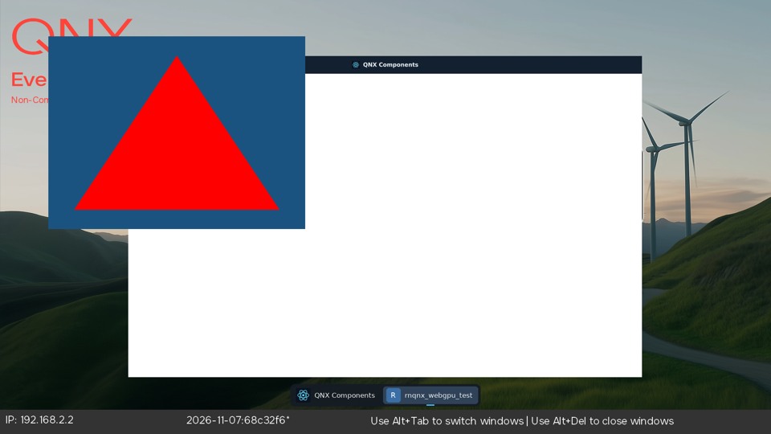

# WebGPU on QNX: Dawn on the Pi 400 (v2 stage 5)

Recorded on 2026-11-13. Stage 5 of the [v2 plan](README.md) asks for a pinned
Dawn/Tint build, a native adapter, reported limits and features, a surface, and
device-loss recovery, proven on the target with a clear, a draw, a readback and
a resize/recreate. This page records what was built, what ran on the Raspberry
Pi 400 and what did not. The [graphics backends page](graphics-backends.md)
keeps the plan-level view.

Nothing here turns on a v1 gate. The new code is outside the default build, and
no JavaScript API, React Native module or Qt Quick item uses it yet.

## What ran on the device

The test app `rnqnx_webgpu_test` ran on the physical Pi 400 (custom BCM2711
image, QNX 8.0.0 kernel string `2026/06/05`, Mesa V3D 4.2 behind QNX Screen). It
opened its own Screen window next to the gallery under `rnqnx-winmgr` and passed
10 of 10 stages:

| Stage                           | What it proves                                                                                                                |
| ------------------------------- | ----------------------------------------------------------------------------------------------------------------------------- |
| `adapter-device`                | Dawn found a `V3D 4.2` OpenGL ES adapter and made a device                                                                    |
| `offscreen-render-readback`     | A clear and a triangle rendered to a texture and read back: corner and centre pixels match the expected colours               |
| `compute`                       | A WGSL compute pass doubled 4096 `u32` values and every value read back correctly                                             |
| `window-and-surface-create`     | A Screen window plus a `wgpu::Surface` configured on it                                                                       |
| `render-to-swapchain-texture`   | Clear and triangle rendered into the surface texture and read back before `Present()`                                         |
| `resize`                        | 800x600, 480x360 and 640x480: Screen reports the new window and buffer size and the swap chain texture has the same size      |
| `surface-recreate`              | The surface dropped and created again from the same window                                                                    |
| `window-recreate`               | The Screen window destroyed and created again, with a new surface                                                             |
| `device-loss-recovery-injected` | `Device::ForceLoss` reported through the loss callback, a new device from the same adapter, surface, render and compute again |
| `no-uncaptured-errors`          | Dawn raised no uncaptured error outside the expected loss                                                                     |

The final result line is `RNQNX_WEBGPU RESULT PASS stages=10 passed=10
verified=1`. The raw log is
[dawn-gles-run-app.log](../evidence/webgpu-qnx-2026-11-13/dawn-gles-run-app.log).

The on-glass check is separate. The stock `screenshot` tool captured the whole
1920x1080 display while the window was held on screen.
[check-screenshot.py](../../scripts/webgpu/check-screenshot.py) reads that
bitmap and found the triangle's red at the window centre and the animated blue
clear colour just inside the window corner
([screenshot-check.txt](../evidence/webgpu-qnx-2026-11-13/screenshot-check.txt)).
The image below is a downscaled copy; the gallery window behind it belongs to
another test session.

### What this does not show

- **The device loss is injected.** `ForceLoss` proves Dawn's loss callback and
  the recreate path. The driver never reports a real GPU reset here: the Mesa
  21.2 EGL has no `EGL_EXT_create_context_robustness`, so Dawn cannot ask for
  reset notification (see patch 0003). A hung GPU would not surface as device
  loss.
- **Nothing was measured for speed.** Every submission waits on `glFinish`
  (patch 0005). Frame times, upload costs and the cost of the readback copies
  are unknown.
- **One run on one board.** The ten stages passed in each of the final runs on
  one Pi 400. No soak, no repeated cold boots, no second board.
- **Only 640x480-class windows ran.** A fullscreen 1920x1080 surface was not
  tried.
- **Qt Quick composition ran through a CPU copy**, not zero-copy, and it was
  checked with `QQuickWindow::grabWindow()` (Qt's own render output), not with a
  display screenshot.
- **Vulkan did not run at all**; the reasons are below.

## What the board offers

[gpu-probe-pi400.txt](../evidence/webgpu-qnx-2026-11-13/gpu-probe-pi400.txt)
holds the raw output of `native/webgpu/probe/qnx_gpu_probe.c`, run on the
board before any backend was chosen.

| Path                                | Result on the Pi 400                                                                                                                                                               |
| ----------------------------------- | ---------------------------------------------------------------------------------------------------------------------------------------------------------------------------------- |
| System Vulkan loader (`libvulkan`)  | Loader 1.4.321, but `vkCreateInstance` fails with `VK_ERROR_INCOMPATIBLE_DRIVER`: the ICD file names `/usr/lib/graphics/rpi4-drm/libvulkan_broadcom.so`, which is not on the board |
| Compat-tree v3dv ICD, loaded direct | Works: `V3D 4.2`, **Vulkan 1.0.182**, one device and one queue family, `VK_QNX_screen_surface` and `VK_KHR_swapchain` present, no Vulkan 1.1 core                                  |
| Stock `/usr/lib/vulkan_broadcom.so` | Instance 1.3.311 creates, but enumerates **zero physical devices** on this board                                                                                                   |
| EGL                                 | Mesa EGL 1.4; no `EGL_EXT_create_context_robustness`; `EGL_KHR_surfaceless_context`, `EGL_KHR_no_config_context`, `EGL_KHR_fence_sync` and `EGL_KHR_reusable_sync` listed          |
| OpenGL ES                           | `OpenGL ES 3.1 Mesa 21.2.4`, renderer `V3D 4.2`, `GL_EXT_color_buffer_float`, `GL_EXT_buffer_storage`, geometry shaders, compute; max texture size 4096                            |

### Why Dawn's OpenGL ES backend, not Vulkan

Dawn's Vulkan backend asserts Vulkan 1.1 (`PhysicalDeviceVk.cpp:236` at the
pinned commit, and `kRequiredVulkanVersion` in `BackendVk.cpp`). The only
working Vulkan driver on this image reports 1.0.182, so the Vulkan backend
cannot create an adapter there. The newer Vulkan driver in `/usr/lib` finds no
device on this board. Neither was fixed or replaced; both are open questions
for a later image. The build therefore compiles Dawn with the OpenGL ES backend
(plus the null backend) and leaves Vulkan off.

That choice has consequences for stage 6. Dawn's OpenGL ES backend only offers
the WebGPU _compatibility_ feature level: the device reports no optional
features (`FEATURES count=0`) and compat-mode limits (for example
`maxStorageBuffersPerShaderStage=8`, `maxComputeInvocationsPerWorkgroup=128`,
`maxBindGroups=4`). Libraries that need `shader-f16`, timestamp queries,
subgroups or core-profile limits will not run on this adapter.

## Pinned closure

| Item                                      | Pin                                                                                                                               |
| ----------------------------------------- | --------------------------------------------------------------------------------------------------------------------------------- |
| Dawn                                      | `1716e88cc9e58398fab5d4473f7f2e858667b677` (Chromium m158 line, 2026-10-23), from `dawn.googlesource.com/dawn`                    |
| Tint                                      | In the Dawn tree; built with the WGSL reader and GLSL writer only                                                                 |
| Dawn dependencies                         | Fetched by Dawn's own `fetch_dawn_dependencies.py` from its `DEPS` at that commit                                                 |
| `react-native-skia` (read, not installed) | tag `v3.10.1`, commit `da8e112a`; `externals/skia` is `75584a96`, whose `DEPS` pins Dawn `1716e88c`                               |
| `react-native-webgpu` (read)              | tag `v0.21.3` / `main` `181982d2`; depends on `react-native-webgpu-dawn` 158.0.0; `scripts/check-dawn.ts` validated at `1716e88c` |

RN WebGPU and Skia v3 therefore agree on the same Dawn commit, and this build
uses it. The pins come from reading the upstream repositories on 2026-11-13. No
upstream package was installed or built.

Mismatches with those upstream closures, all of which stage 6 has to settle:

1. **Backend set.** Skia's `dawn-configuration.ts` builds Dawn with Vulkan on
   Android and Metal on Apple, and says OpenGL ES is "deliberately left out".
   This QNX build is OpenGL ES only. Whether Skia Graphite's Dawn backend works
   over Dawn's OpenGL ES backend is untested here.
2. **Local patches.** Five patches sit on top of the commit (below). Upstream's
   own Skia patches (`metal-maccatalyst`, `metal-suspend-submissions-in-background`,
   `vulkan-fifo-three-images-android`) do not apply to this backend.
3. **Surface source.** RN WebGPU's `makeSurface` selects an Android window or a
   Metal layer. On QNX the surface carries a `screen_window_t` in the Android
   window slot (patch 0002); RN WebGPU needs a QNX branch that does the same.
4. **Library shape.** Upstream ships a monolithic `libwebgpu_dawn` per platform
   in an npm package. This build produces the equivalent static
   `libwebgpu_dawn.a` (25.7 MB with `-O1`) but no package.

## Local patches to Dawn

[`patches/webgpu/dawn/`](../../patches/webgpu/dawn) holds the patches.
`scripts/webgpu/fetch-dawn.sh` applies them to the pinned checkout.

| Patch                                   | Change                                                                                                                                  | Risk                                                                                                       |
| --------------------------------------- | --------------------------------------------------------------------------------------------------------------------------------------- | ---------------------------------------------------------------------------------------------------------- |
| 0001 `qnx-platform-macro`               | `src/utils/platform.h` knows `__QNX__` and treats it as POSIX (not Linux)                                                               | Small                                                                                                      |
| 0002 `qnx-screen-window-surface`        | `SurfaceSourceAndroidNativeWindow::window` carries a `screen_window_t` on QNX; the EGL swap chain passes it to `eglCreateWindowSurface` | Reuses an Android sType for another meaning. A dedicated sType would need a `dawn.json` change; deferred   |
| 0003 `gles-optional-context-robustness` | `EGL_EXT_create_context_robustness` is optional: Dawn logs a warning and creates the context without robust access                      | Tint still bounds-checks shaders, but the driver reports no GPU reset, so real device loss is not detected |
| 0004 `qnx-system-utils`                 | `GetExecutablePath`/`GetModulePath` for QNX (`/proc/self/exefile`, `dladdr`)                                                            | Small                                                                                                      |
| 0005 `gles-fence-fallback`              | When `eglCreateSyncKHR` returns no sync, `Queue::SubmitFenceSync` calls `glFinish` and treats the serial as complete                    | Every submission blocks until the GPU is done. **Not root-caused**: see below                              |

About patch 0005. On the Pi, `eglCreateSyncKHR` succeeds in a plain EGL
context (the probe tried fresh, idle, surfaceless and no-config contexts, with
and without prior GL work) but returns `EGL_NO_SYNC` with `EGL_SUCCESS` inside
Dawn's context, for both fence and reusable types, even after `glFlush`. The
difference between the two contexts was not found. Without a fallback the first
submit marks the device lost. The fallback is a workaround; correct completion
tracking needs the real cause.

## Build recipe

Two compilers produce the same sources; the choice is about speed.

1. `scripts/webgpu/fetch-dawn.sh <dir>` fetches the pinned commit and applies
   the patches.
2. `scripts/webgpu/build-dawn.sh <dir> <build>` configures and builds Dawn with
   the repository's SDP gcc toolchain (`cmake/toolchains/qnx-8.0.cmake`). Run it
   in the `qnx805-build` container; it needs network on first configure and about
   20 GB, which the container has and the Mac does not. It compiled the first
   hundred or so objects without source errors, but the SDP's gcc is an x86-64
   binary running under Rosetta, and with the container shared with other builds
   (load average above 30) it finished too few files per hour to complete.
3. `cmake/toolchains/qnx-8.0-clang.cmake` builds the same tree with LLVM clang
   against the SDP sysroot. **The device run used this path**: Homebrew LLVM 23.1
   on the Mac, build tree on a 2 GB RAM disk because the Mac volume had about
   3 GB free, objects archived by `llvm-ar`. That deviates from "build in the VM";
   the VM could not finish the build in useful time. The clang toolchain needs
   three workarounds, each in the file or in `native/webgpu/shim/LibcxxShim.cpp`:
   the target triple has no QNX operating system (the file supplies the macros the
   SDP's gcc predefines), `QNX_LIBM_BUILTINS` for libc++'s math wrappers, and a
   shim for three libc++ members that the SDP's `libc++.so` does not export
   (`basic_ostringstream::str() const &`, `basic_stringstream::str() const &`,
   and an untagged alias for `basic_ifstream(const string&, openmode)`, which
   clang mangles without the ABI tag that gcc adds).
4. `scripts/webgpu/build-testapp.sh <dawn-src> <dawn-build> <out>` links the test
   app with the SDP's `qcc` inside the container. Set
   `RNQNX_WEBGPU_LIBCXX_SHIM=ON` when Dawn came from the clang path.
5. `scripts/webgpu/run-on-pi.sh <binary> <evidence-dir>` copies the binary and
   `rnqnx-webgpu-launch.sh` to a new directory under
   `/data/home/qnxuser/rnqnx-webgpu/`, starts only that binary, waits for its
   ready marker, takes a screenshot (with `sudo -n`, because the stock tool
   cannot create a Screen context as `qnxuser`) and copies the run back. It
   signals only the process it started.

Dawn flags: `DAWN_ENABLE_OPENGLES=ON`, `DAWN_ENABLE_NULL=ON`,
`DAWN_ENABLE_VULKAN=OFF`, `DAWN_BUILD_MONOLITHIC_LIBRARY=STATIC`, Tint SPIR-V
reader/writer and the GLSL validator off, no X11/Wayland/GLFW.

Two things about running the app: the Screen window needs `screen_create_window_buffers`
before `eglCreateWindowSurface` (libEGL aborts the process otherwise), and a
resize destroys and recreates the window buffers after the swap chain has
released the old EGL surface.

## The test app

`native/webgpu/testapp` is a small C++20 program, not part of the gallery. It
logs lines that start with `RNQNX_WEBGPU` and exits non-zero unless every stage
passed. `--backend=null` runs against Dawn's null backend, which executes no
GPU work: it validates the API calls and the WGSL, and the result line says
`verified=0`.

| File                    | Role                                                                  |
| ----------------------- | --------------------------------------------------------------------- |
| `GpuContext`            | Instance, adapter, device, loss callback, limits and features         |
| `Scenarios`             | Triangle renderer, compute dispatch, texture readback                 |
| `ScreenWindow`          | QNX Screen window, buffers, resize, close events                      |
| `SurfacePresenter`      | `wgpu::Surface` lifecycle on that window                              |
| `main.cpp`              | The stages above, per-stage uncaptured-error checks, signal logging   |
| `shim/LibcxxShim.cpp`   | libc++ members for a clang-built Dawn                                 |
| `probe/qnx_gpu_probe.c` | Plain Vulkan and EGL capability probe, used before any backend choice |

## Surface and composition

A WebGPU surface on QNX is a Screen window of its own. Screen composes it
with the rest of the desktop; `rnqnx-winmgr` lists it in its dock. That path
ran.

Composition into the Qt Quick scene graph is a separate path.
`native/webgpu/qt-compose` renders on a worker thread that owns the Dawn
device (so Dawn never makes its EGL context current under Qt's), reads each
frame back, and uploads it as a `QSGTexture` in a Qt Quick item.
`QtGraphicsSurface` from stage 1 observes the window. It copies pixels through
the CPU; a zero-copy path would import a Qt-owned texture into Dawn as an EGL
image, which this stage did not attempt. That path ran on the Pi 400
([qt-compose-run.log](../evidence/webgpu-qnx-2026-11-13/qt-compose-run.log)):
`QtGraphicsSurface` reported `Initialized` with backend `OpenGL` for the
640x480 window, 249 frames were produced and uploaded in eight seconds, and a
`grabWindow()` of the scene showed the triangle's red at the item centre, a black
window corner, and an item corner whose green channel moved from 53 to 83 between
two grabs, so new frames reach the scene graph. The result line is
`RESULT PASS compose red_center=1 black_window_corner=1 animated=1`. Only this one
run exists. Frame time, copy cost and CPU load were not measured.

## Device loss and recovery

`GpuContext` keeps its shared state in a member declared first, so Dawn's loss
and error callbacks still have valid state while the device is released.
`recreateDevice()` requests a second device from the same adapter (the instance
needs `MultipleDevicesPerAdapter`). After a loss the surface and pipeline are
dropped and rebuilt, because both belong to the lost device. This ran on the
Pi with an injected loss. It did not run with a real one.

## Host tests

`.github/workflows/webgpu-host.yml` builds the pinned Dawn on Linux with only
the null backend and runs the test app with `--backend=null --headless`. It is
manual and weekly, not a pull request check: a Dawn build takes well over half
an hour on a hosted runner. It was **not run** before this page was written, so
no hosted result backs it. The null backend cannot confirm pixels or compute
values; only the Pi run does.

## For stage 6

- RN WebGPU, TypeGPU and Three.js can ask this adapter for a compatibility
  device. Features outside compat mode are absent.
- The surface hook RN WebGPU needs on QNX is the Android-window slot carrying a
  `screen_window_t`, plus window buffers created before the surface.
- Skia Graphite over Dawn's OpenGL ES backend is untested and upstream does not
  build it.
- Every submit currently blocks on `glFinish`. A real fix for the missing EGL
  fence would change frame pacing for all three consumers.
- The Vulkan route needs a Vulkan 1.1 driver on this image first.
